# maily

**Self-hosted multi-provider temporary email API with a sleek admin dashboard & modern async Python client.**

Create disposable mailboxes on demand, receive emails in real time, extract verification codes and confirmation links automatically — all through one clean REST API, an async-first Python client, and a dark-themed web console. Runs locally or in Docker, stores state in SQLite, and protects access with scoped API keys and encrypted credentials.

[](https://github.com/stormsia/maily/actions/workflows/ci.yml)
[](https://github.com/stormsia/maily/actions/workflows/codeql.yml)
[](https://github.com/stormsia/maily/actions/workflows/pip-audit.yml)
[](https://github.com/stormsia/maily/actions/workflows/gitleaks.yml)
[](https://codecov.io/gh/stormsia/maily)
[](https://github.com/stormsia/maily/pkgs/container/maily)
[](https://pypi.org/project/maily-server/)
[](https://pypi.org/project/maily-client/)
[](https://stormsia.github.io/maily/)
[](https://github.com/stormsia/maily)
[](LICENSE)

---

## ✨ Features

- **8 Supported Providers** — Aggregates public temporary-mail networks and private Gmail accounts:
  - `mail.tm` — High reliability, custom usernames, passwords, full MIME source
  - `tempmail.plus` — Custom usernames, PIN protection, domains, MIME source
  - `temp-mail.io` — Disposable web mailboxes with automatic CORS tokens
  - `noopmail.org` — Domain rotation and raw source inspection
  - `anonymmail.net` — Session & CSRF-managed disposable mail
  - `dispoemail.org` — Astro-session based disposable mail
  - `temp.tf` — Real provider aliases on Outlook, Hotmail, Gmail, and high.edu.pl with plus/dot syntax
  - `gmail` — OAuth2 integration with unlimited `username+alias@gmail.com` mailboxes
- **Magic Verification Extraction** — Wait for an incoming email and automatically extract 4–8 digit verification codes (e.g. `849201`) or confirmation action links with a single async call.
- **Async Python Client** — Zero-dependency standalone client (`httpx`, `pydantic`, `loguru`) with async context managers, async iterators, typed pydantic models, and granular exceptions.
- **Real-Time Streaming** — Stream incoming messages via `async for message in api.messages.iter_messages(box): ...`.
- **Admin Dashboard & Developer Hub** — Modern dark-mode UI with live charts, message preview with verification highlights, auto-refresh polling, and an integrated Swagger / API documentation explorer at `/docs`.
- **Scoped API Keys** — Root keys and granular issued keys with provider/action/parent restrictions and custom TTL cleanup rules.
- **Automatic Retention & DB Maintenance** — Configurable background worker sweeps expired mailboxes and messages based on TTL policies, paired with automatic throttled database maintenance (WAL truncate, VACUUM, REINDEX, ANALYZE, PRAGMA optimize, quick_check) to defragment storage and optimize query performance without downtime.
- **Domain Cache** — Periodic background cache of provider domains with instant refresh.
- **Docker-Ready** — Hermetic multi-stage Docker build with SQLite volume persistence.

---

## 🌐 Supported Providers & Capabilities

| Provider | Target Kind | Custom Username | Custom Domain | Passwords / PIN | Raw Source | Read Tracking |
|---|---|---|---|---|---|---|
| **mail.tm** | `domain` | ✅ Supported | ✅ Supported | ✅ Password | ✅ Supported | ✅ Supported |
| **tempmail.plus** | `domain` | ✅ Supported | ✅ Supported | ✅ PIN Code | ✅ Supported | ✅ Supported |
| **temp-mail.io** | `domain` | ✅ Supported | ✅ Supported | ❌ No | ✅ Supported | ⚪ No-op |
| **noopmail.org** | `domain` | ✅ Supported | ✅ Supported | ❌ No | ✅ Supported | ⚪ No-op |
| **anonymmail.net** | `domain` | ✅ Supported | ✅ Supported | ❌ No | ✅ Supported | ⚪ No-op |
| **dispoemail.org** | `domain` | ✅ Supported | ✅ Supported | ❌ No | ✅ Supported | ⚪ No-op |
| **temp.tf** | `domain` | ✅ Supported | ✅ Supported | ❌ No | ✅ Supported | ⚪ No-op |
| **gmail** | `parent` | ✅ `+alias` | ❌ Own Account | ❌ OAuth2 | ✅ Supported | ✅ Supported |

> 💡 **Extending Providers:** Want to add your own provider? Check out the comprehensive guide for developers and AI agents in [docs/ADDING_PROVIDERS.md](docs/ADDING_PROVIDERS.md).

<!-- provider-status:start -->
### 🌐 Live Provider Operational Status

> **Last Verified:** `2026-11-02 15:05 UTC` | **Overall Health:** 🟡 **Degraded Performance**

| Provider | Slug | Targets | API Health | E2E Delivery | Latency | Status |
| :--- | :--- | :---: | :---: | :---: | :---: | :---: |
| [Mail.tm](https://mail.tm) | `mail.tm` | 1 | 🟢 PASS | 🔴 Failed | `1.67s` | 🔴 Delivery Outage |
| [TempMail Plus](https://tempmail.plus) | `tempmail.plus` | 8 | 🟢 PASS | 🟢 `4.4s` | `1.05s` | 🟢 Operational |
| [TempMail.io](https://temp-mail.io) | `temp-mail.io` | 6 | 🟢 PASS | 🟢 `6.1s` | `0.77s` | 🟢 Operational |
| [Temp.tf](https://temp.tf) | `temp.tf` | 4 | 🟢 PASS | 🟢 `20.7s` | `0.68s` | 🟢 Operational |
| [AnonymMail.net](https://anonymmail.net) | `anonymmail.net` | 6 | 🟢 PASS | 🟢 `34.1s` | `51.39s` | 🟢 Operational |
| [DispoEmail.org](https://dispoemail.org) | `dispoemail.org` | 4 | 🟢 PASS | 🟢 `3.6s` | `0.84s` | 🟢 Operational |
| [NoopMail.org](https://noopmail.org) | `noopmail.org` | 13 | 🟢 PASS | 🟢 `6.2s` | `15.27s` | 🟢 Operational |

*Automated health checks run twice daily via GitHub Actions.*
<!-- provider-status:end -->

---

## 🚀 Quick Start

### Option A — Docker (Pre-built Image, No Git Clone Required)

The fastest and recommended way to run **maily** in production without cloning the repository or building from source:

#### 1. In One Command (`docker run`)

```bash
docker run -d \
  --name maily \
  -p 8477:8477 \
  -e MAILY_API_KEY=your_secret_api_key \
  -v maily_data:/data \
  --restart unless-stopped \
  ghcr.io/stormsia/maily:latest
```

#### 2. Using Docker Compose

Download only the production Compose configuration:

```bash
# Linux / macOS (curl)
curl -O https://raw.githubusercontent.com/stormsia/maily/main/docker-compose.prod.yml
docker compose -f docker-compose.prod.yml up -d

# Windows (PowerShell)
Invoke-WebRequest -Uri https://raw.githubusercontent.com/stormsia/maily/main/docker-compose.prod.yml -OutFile docker-compose.prod.yml
docker compose -f docker-compose.prod.yml up -d
```

#### Updating the Pre-built Image

```bash
# If using Docker Compose:
docker compose -f docker-compose.prod.yml pull
docker compose -f docker-compose.prod.yml up -d

# If using docker run:
docker pull ghcr.io/stormsia/maily:latest
docker stop maily && docker rm maily
docker run -d --name maily -p 8477:8477 -e MAILY_API_KEY=your_secret_api_key -v maily_data:/data --restart unless-stopped ghcr.io/stormsia/maily:latest
```

- Web Dashboard: <http://127.0.0.1:8477/>
- API Documentation: <http://127.0.0.1:8477/docs>

---

### Option B — Build from Source / Development

#### 1. Docker Compose (Local Build)

```bash
git clone https://github.com/stormsia/maily.git && cd maily
cp .env.example .env        # adjust if needed
docker compose up -d --build
```

To update when building from source:
```bash
git pull
docker compose up -d --build
```

#### 2. Local Python (Python 3.13+)

##### From PyPI (Recommended for Python CLI)

```bash
pip install maily-server
maily
```

##### From Git Source (Development)

```bash
git clone https://github.com/stormsia/maily.git && cd maily
python -m venv .venv
# Windows:
.venv\Scripts\activate
# Linux / macOS:
source .venv/bin/activate

pip install -e ".[dev]"
maily
```

Development server with auto-reload:
```bash
uvicorn maily.app.main:create_app --factory --reload --port 8477
```

---

## 🐍 Standalone Python Client SDK (`maily-client`)

The repository includes a dedicated, self-contained standalone Python client package (`maily-client`) requiring only `httpx`, `pydantic`, and `loguru`. It supports both high-concurrency `async/await` (`Maily`) and a synchronous facade (`SyncMaily`).

> 📖 **Full Documentation:** See [docs/CLIENT_GUIDE.md](docs/CLIENT_GUIDE.md) and [client/README.md](client/README.md) for comprehensive recipes (Pytest fixtures, Playwright/Selenium automation, streaming, and retry policies).

### Installation

#### Preferred — PyPI package:

```bash
pip install maily-client
```

#### Alternative options:

```bash
# Directly from GitHub repository:
pip install "maily-client @ git+https://github.com/stormsia/maily.git#subdirectory=client"

# Or download the zero-dependency single-file client directly into your project:
curl -O https://raw.githubusercontent.com/stormsia/maily/main/client/client.py
```

> ⚠️ **Important: Attribute Access vs Dictionary Key Access**
>
> In `maily-client`, native dot/attribute access is supported **ONLY on Pydantic models and specifically `ExtractedConfirmation`** (which implements `Mapping` and supports dual access: e.g. `res.subject`, `res.confirmation_code` as well as `res["confirmation_link"]`).
>
> All other client methods returning standard Python dictionaries (such as `await api.config.get()`) **DO NOT support attribute/dot access**. You MUST use standard dictionary key indexing (`dict["key"]`), never dot access (`dict.key`).

### 1-Line Mailbox & Verification Code Extraction

```python
import asyncio
from maily.client import Maily, WaitTimeoutError


async def main():
    async with Maily("http://127.0.0.1:8477", api_key="sk-...") as api:
        # Create a disposable mailbox with automatic domain selection
        box = await api.create_temp_mailbox()
        print(f"Disposable email: {box.address}")

        # Send an email to box.address, then wait for the code:
        try:
            code = await api.wait_for_code(box, timeout=60.0)
            print(f"Received verification code: {code}")
        except WaitTimeoutError:
            print("Timed out waiting for email.")


asyncio.run(main())
```

### Confirmation Extraction (`ExtractedConfirmation` Dual Access)

```python
async with Maily("http://127.0.0.1:8477") as api:
    box = await api.create_temp_mailbox()

    # Wait for email and extract both verification code and activation link
    res = await api.wait_for_confirmation_email(box, digit_code_mask=r"\b(\d{6})\b")
    if res is not None:
        # 1. Attribute / dot access:
        print(f"Subject: {res.subject}")
        print(f"Code: {res.confirmation_code}")

        # 2. Key mapping access:
        print(f"Link: {res['confirmation_link']}")
        print(f"Code: {res['confirmation_code']}")
```

### Synchronous Client (`SyncMaily`)

```python
from maily.client import SyncMaily

with SyncMaily("http://127.0.0.1:8477", api_key="sk-...") as api:
    box = api.create_temp_mailbox()
    code = api.wait_for_code(box, timeout=45.0)
    print(f"Received code synchronously: {code}")
```

### Confirmation Link Extraction

```python
async with Maily("http://127.0.0.1:8477") as api:
    box = await api.create_temp_mailbox(provider="tempmail.plus")
    print(f"Address: {box.address}")

    # Automatically extracts URLs containing 'confirm', 'verify', or 'activate'
    link = await api.wait_for_link(box, timeout=90.0)
    print(f"Confirmation URL: {link}")
```

### Real-Time Email Streaming (Async Iterator)

```python
async with Maily("http://127.0.0.1:8477") as api:
    box = await api.mailboxes.create(domain="mail.tm")

    # Continuously yields new messages as they arrive
    async for msg in api.messages.iter_messages(box, poll_interval=2.0, timeout=120.0):
        print(f"Incoming: {msg.subject} from {msg.from_address}")
        detail = await api.messages.get(box, msg.message_api_id)
        print("Body text:\n", detail.text)
```

### Granular Exception Handling

All API errors inherit from `ApiError`, which inherits from `ClientError`:

```python
from maily.client import (
    AuthenticationError,  # 401: Invalid API key
    ForbiddenError,  # 403: Scope denied
    NotFoundError,  # 404: Mailbox or message missing
    ValidationError,  # 422 / 400: Bad params
    RateLimitError,  # 429: Rate limited
    UpstreamProviderError,  # 502/504: Provider downtime
    WaitTimeoutError,  # Timeout waiting for email/code
)

try:
    detail = await api.messages.get(box, "unknown_id")
except NotFoundError:
    print("Message not found!")
except AuthenticationError:
    print("Check your API key!")
```

### Scoped API Key Management

```python
async with Maily("http://127.0.0.1:8477", api_key="root_secret") as api:
    # Create key restricted to mail.tm only
    new_key = await api.keys.create(
        name="bot-worker",
        scope={"providers": ["mail.tm"], "parent_ids": [], "actions": ["read", "write"]},
    )
    print(f"Key Prefix: {new_key.prefix} | Secret: {new_key.secret}")
```

### Retention & Database Maintenance

```python
async with Maily("http://127.0.0.1:8477", api_key="root_secret") as api:
    # Run regular retention sweep (triggers DB maintenance if interval has elapsed)
    res = await api.admin.retention_run()
    print(f"Deleted: {res.mailboxes_deleted} boxes, {res.messages_deleted} messages")

    # Or force immediate full database maintenance (VACUUM, REINDEX, ANALYZE):
    res = await api.admin.retention_run(force_maintenance=True)
```

---

## 🖥️ Web Dashboard & Documentation Hub

Access the admin console at <http://127.0.0.1:8477/>:

- **Overview** — Live metrics, incoming message 7-day trend, active providers, and manual retention sweep.
- **Mailboxes** — Instant search, filter by provider, 1-click address copy, and creation dialog with provider capability awareness.
- **Message Reader** — Reading pane with automatic **Quick Extract** card (highlighting 6-digit codes and action links with 1-click copy), formatted HTML / Raw HTML tabs, RFC822 source viewer, and user-controllable auto-refresh interval (5s / 10s / 30s / Off).
- **API Keys** — Create and manage scoped keys, reveal secrets, and test the dashboard under a specific key identity.
- **Retention & Database Maintenance** — Real-time cache status, scheduled refresh intervals, TTL cleanups, and automated database maintenance (VACUUM, REINDEX, ANALYZE).
- **Developer Hub (`/docs`)** — Multi-tab developer portal featuring interactive Swagger UI with automatic API key preauthorization, Python client snippets, provider status matrix, and dynamic cURL commands.

---

## 🛡️ Architecture & CI/CD Pipeline

The project implements a state-of-the-art continuous integration and delivery architecture with multi-layer security scanning:

```mermaid
flowchart LR
    subgraph CI["Fast Feedback CI (< 90s)"]
        lint["Ruff + HTMLHint"]
        alembic["Alembic Migrations Check"]
        deptry["Deptry Clean Dependencies"]
        mypy["Mypy Strict Type Check"]
        pytest["Pytest Matrix (3.13-3.15) + Coverage >= 80%"]
        smoke["Docker Runtime Smoke Test"]
    end

    subgraph Security["Security & SAST"]
        codeql["CodeQL SAST (Python + JS)"]
        gitleaks["Gitleaks Secret Scanning"]
        pipaudit["pip-audit PyPA Advisory CVE"]
        trivy["Trivy Container & OS Scan"]
    end

    subgraph CD["Release & Distribution"]
        pypi["PyPI Trusted Publisher (OIDC)"]
        ghcr["Multi-Arch GHCR (amd64/arm64)"]
        sbom["SPDX Signed SBOM"]
        pages["GitHub Pages Interactive Docs"]
    end

    CI --> Security --> CD
```



### Security & Compliance Controls
1. **GitHub CodeQL Analysis** — Deep semantic static application security testing (SAST) detecting SQL injection, path traversal, and SSRF.
2. **Gitleaks Secret Scanning** — Pre-merge blocking of accidental token, key, or credential commits (`.gitleaks.toml` configured).
3. **Trivy Container Scanner** — Full CVE inspection of Debian Bookworm OS packages and Python wheels exported directly to the **GitHub Security tab (SARIF)**.
4. **pip-audit** — Automated vulnerability audit against the PyPA Advisory Database.
5. **Hermetic Test Suite** — 360+ tests passing hermetically with 80%+ code coverage across Python 3.13, 3.14, and 3.15.

---

## ⚙️ Configuration Reference

Copy `.env.example` to `.env` and customize:

| Variable | Default | Description |
|---|---|---|
| `MAILY_HOST` | `127.0.0.1` | Bind address (`0.0.0.0` in Docker) |
| `MAILY_PORT` | `8477` | HTTP port |
| `MAILY_API_KEY` | *(empty)* | Root master key. If empty on loopback, open root access is allowed. Non-loopback requires a key. |
| `MAILY_DATABASE_URL` | `sqlite+aiosqlite:///mailtm.db` | SQLite database URI |
| `MAILY_SECRET_KEY` | *(auto-generated)* | Fernet encryption key used to protect credentials |
| `MAILY_PROXY` | *(empty)* | Optional HTTP/SOCKS5 proxy for upstream provider requests |
| `MAILY_RETENTION_INTERVAL_SECONDS` | `60` | Background retention sweep frequency |
| `MAILY_DB_MAINTENANCE_ENABLED` | `true` | Enable periodic database maintenance during retention |
| `MAILY_DB_MAINTENANCE_INTERVAL_MINUTES` | `60` | Minimum interval between database maintenance runs (in minutes) |
| `MAILY_SQLITE_BUSY_TIMEOUT_MS` | `60000` | SQLite lock wait timeout in ms to prevent request drops during maintenance |
| `MAILY_DOMAIN_CACHE_INTERVAL_SECONDS` | `1800` | Background domain refresh frequency |
| `MAILY_GMAIL_CLIENT_ID` | *(empty)* | Google OAuth2 Client ID |
| `MAILY_GMAIL_CLIENT_SECRET` | *(empty)* | Google OAuth2 Client Secret |
| `MAILY_TEMP_TF_GMAIL_DOT` | `true` | Enable dot-aliased Gmail addresses for temp.tf (`user.name@gmail.com`) |
| `MAILY_TEMP_TF_GMAIL_PLUS` | `true` | Enable plus-aliased Gmail addresses for temp.tf (`username+tag@gmail.com`) |

---

## 🧪 Testing & Code Quality

The repository has 100% passing tests and strict typing and linting checks:

```bash
# Run full test suite across all workers
python -m pytest

# Run ruff linter & formatter checks
uv run ruff check src tests client scripts

# Run mypy static type checking
uv run mypy src client scripts

# Check Alembic migrations consistency
uv run alembic upgrade head
uv run alembic check

# Verify clean pyproject.toml dependencies
uvx deptry src

# Verify standalone client mirror integrity
python scripts/build_client.py --check
```

---

## 📄 License

MIT © [stormsia](https://github.com/stormsia)
