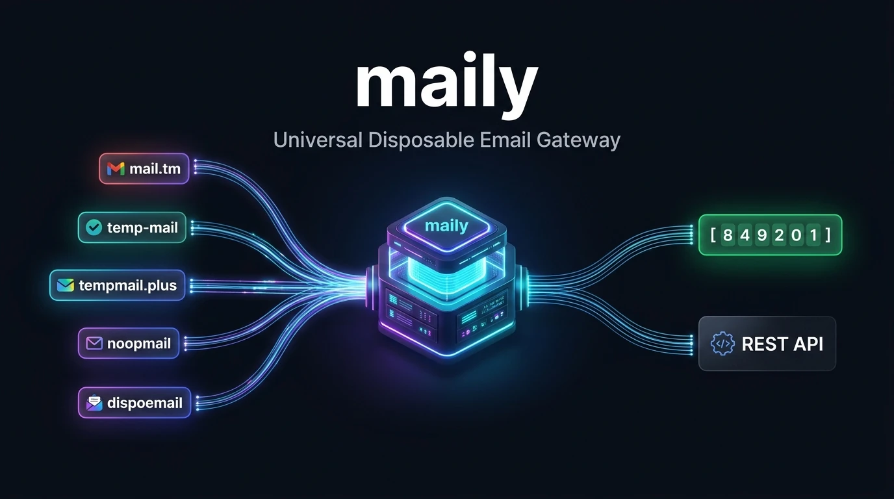
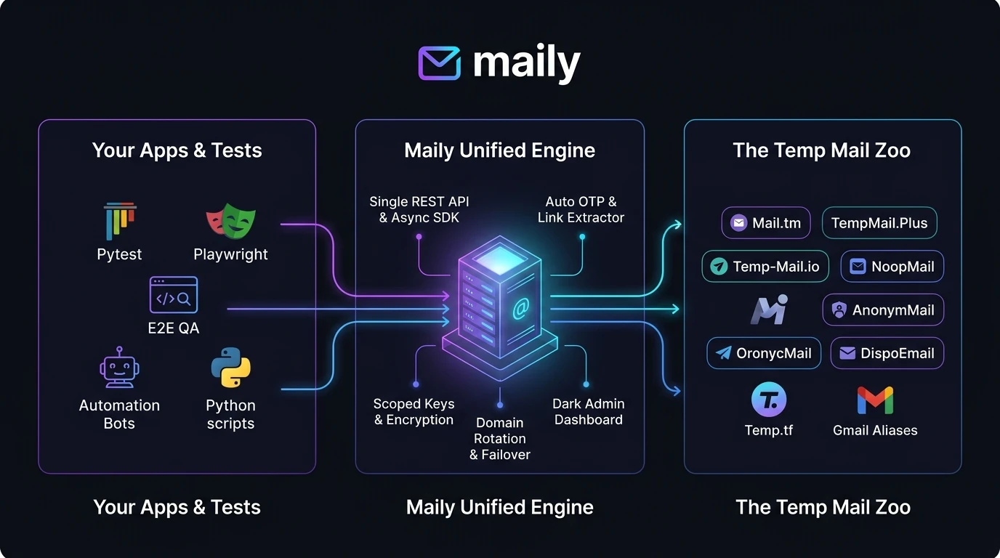
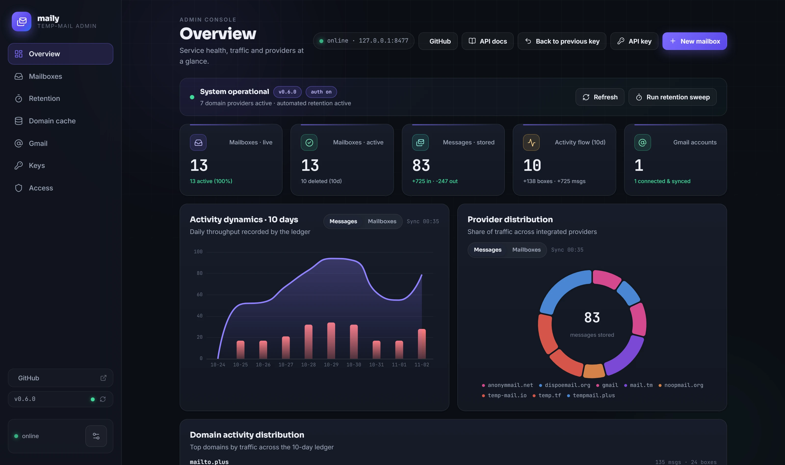
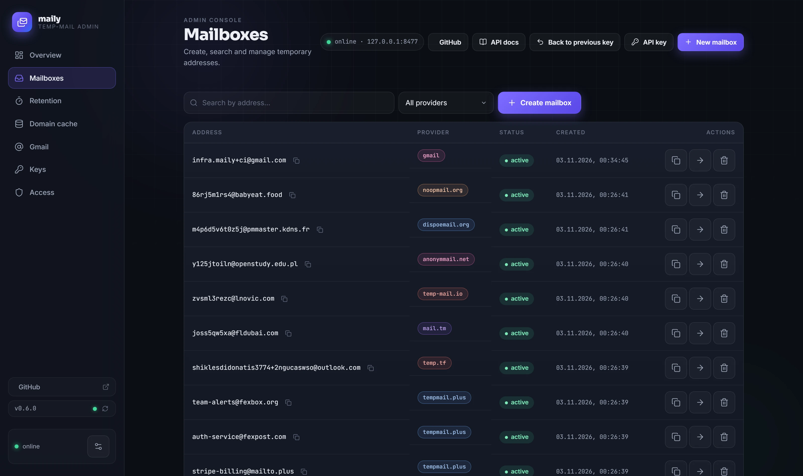
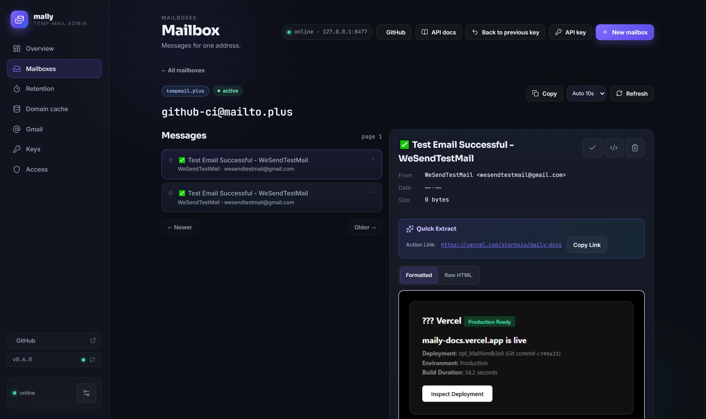
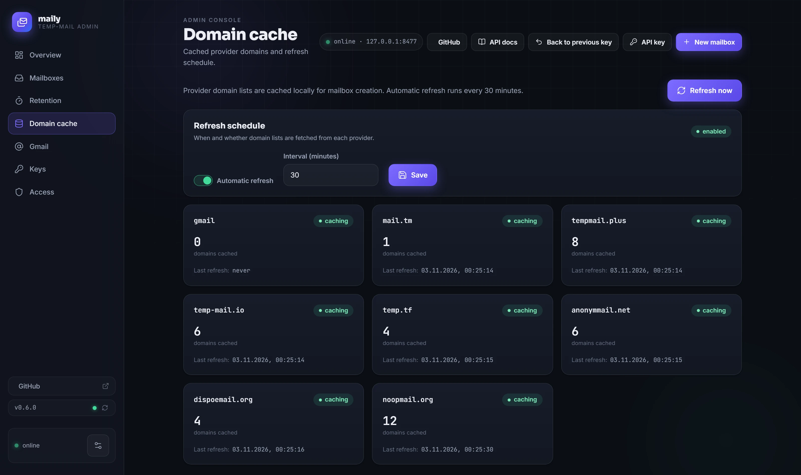
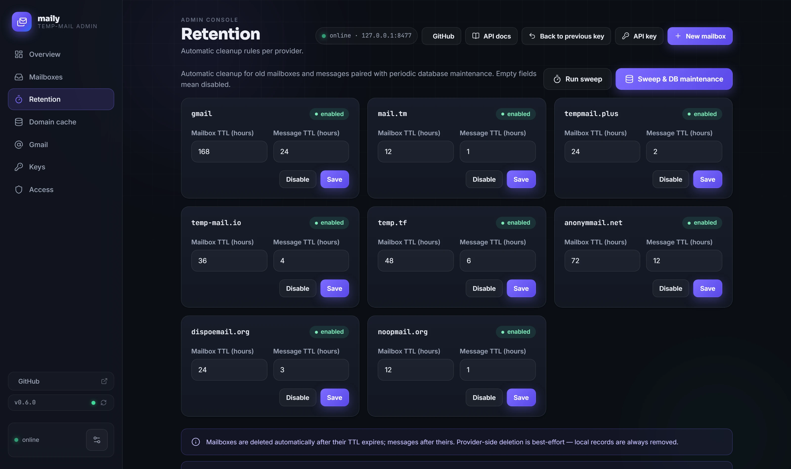
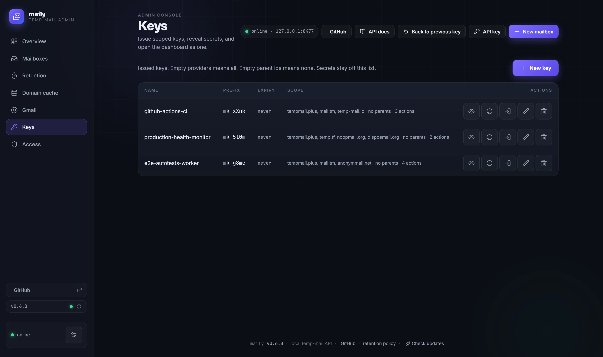

<p align="center">
  
</p>

<div align="center">

# ✉️ maily

### The Universal Temporary Email Gateway & REST API Platform

**Taming the disposable email zoo (Mail.tm, TempMail, 1secmail alternatives) under a single high-performance REST API, modern async Python SDK, and dark-mode web console.**

<br>

> ⚡ **Universal Temp Mail API to Rule the Disposable Email Zoo:** Stop wrestling with 8 incompatible temp-mail APIs, daily domain blacklists, and fragile regexes. Maily acts as a resilient, drop-in 1secmail alternative aggregating Mail.tm, Tempmail Plus, Temp-Mail.io, and 5+ disposable email providers into one unified REST gateway with 1-line automatic OTP verification code extraction for Playwright, Pytest, and QA bots.
>
> 🇷🇺 **Универсальный шлюз и REST API временной почты:** объединяем зоопарк temp-mail сервисов (надёжная замена 1secmail, Mail.tm, TempMail) в едином быстром REST API с удобным тёмным веб-интерфейсом и мгновенным извлечением проверочных OTP кодов.

<br>

[](https://github.com/stormsia/maily/actions/workflows/ci.yml)
[](https://github.com/stormsia/maily/actions/workflows/codeql.yml)
[](https://github.com/stormsia/maily/actions/workflows/pip-audit.yml)
[](https://github.com/stormsia/maily/actions/workflows/gitleaks.yml)
[](https://codecov.io/gh/stormsia/maily)
[](https://github.com/stormsia/maily/pkgs/container/maily)
[](https://pypi.org/project/maily-server/)
[](https://pypi.org/project/maily-client/)
[](https://stormsia.github.io/maily/)
[](https://github.com/stormsia/maily)
[](https://github.com/stormsia/maily/blob/main/LICENSE)

[📖 Interactive Docs & Swagger](https://stormsia.github.io/maily/) •
[🚀 Server Package (PyPI)](https://pypi.org/project/maily-server/) •
[📦 Client SDK (PyPI)](https://pypi.org/project/maily-client/) •
[🐳 Docker GHCR](https://github.com/stormsia/maily/pkgs/container/maily) •
[🌐 Live Provider Health](#-live-provider-operational-status) •
[⚡ Quick Start](#-quick-start) •
[🧪 Test Automation Recipes](#-e2e-test-automation-recipes-pytest-playwright-selenium)

</div>

---

## 🦁 Why Maily? Taming the Disposable Email Zoo

Integrating disposable email into automated tests, QA pipelines, or bots usually means dealing with an unmaintainable nightmare:

* 💥 **8 incompatible, brittle APIs** — Each provider has custom headers, obscure JSON shapes, non-standard timestamps, or missing MIME source.
* 🛑 **Random downtime & domain blacklists** — Upstream domains get blocklisted daily, breaking your E2E test suites with zero warning.
* 🧩 **Complex regex parsing** — Writing and maintaining brittle regexes to fish 4–8 digit OTP codes and activation links out of raw HTML.
* 🔓 **Zero security & isolation** — No access controls, no credential encryption, no audit log, and no retention sweep.

**Maily solves this once and for all.** It acts as a resilient, high-availability abstraction gateway over the entire temp-mail ecosystem. Switch or rotate providers dynamically with a single parameter, automatically extract verification codes, and control everything from a sleek dark dashboard or async Python SDK.

| Capability | Fragmented Provider Zoo ❌ | Maily Universal Gateway ⚡ |
|---|---|---|
| **API Uniformity** | 8+ different endpoints, schemas & authentication rules | **Single normalized REST API & Python SDK** |
| **Domain Reliability** | Single point of failure; breaks when domain is blocked | **40+ rotating domains across 8 provider fleets** |
| **OTP Code Extraction** | Manual HTML scraping, regex writing, and polling loops | **`await api.wait_for_code(box)` (instant 1-line extraction)** |
| **Activation Links** | Hardcoded regex URL patterns | **`await api.wait_for_link(box)` with auto-scoring** |
| **Execution Engines** | Custom HTTP requests with unhandled 429/502 retries | **Native Async (`Maily`) + Sync facade (`SyncMaily`)** |
| **Observability** | Blind execution; logs scattered everywhere | **Dark-mode web console with live telemetry & charts** |
| **Security & Privacy** | Public endpoints with zero key control | **Multi-tenant scoped API keys & Fernet-encrypted credentials** |
| **State Maintenance** | Orphaned mailboxes & bloated disks | **Background retention sweep + zero-downtime VACUUM** |

---

## 🏗️ Architecture & Data Flow

```mermaid
flowchart LR
    subgraph Clients["1. Clients & Test Suites"]
        direction TB
        pytest["Pytest Automation"]
        playwright["Playwright / Selenium"]
        bot["QA Bots & Scrapers"]
        sdk["maily-client (Async / Sync)"]
    end

    subgraph Gateway["2. Maily Unified Engine"]
        direction TB
        fastapi["FastAPI High-Speed Core"]
        extractor["Magic OTP & Link Extractor"]
        rbac["Scoped RBAC & Fernet Vault"]
        cache["Domain Cache & Auto-Failover"]
        retention["Retention Sweeper & SQLite WAL"]
        ui["Dark-Mode Admin Dashboard"]
    end

    subgraph Zoo["3. The Temp Mail Zoo"]
        direction TB
        p1["Mail.tm"]
        p2["TempMail.Plus"]
        p3["Temp-Mail.io"]
        p4["NoopMail.org"]
        p5["AnonymMail.net"]
        p6["DispoEmail.org"]
        p7["Temp.tf"]
        p8["Gmail OAuth2 + Aliases"]
    end

    Clients -->|Single REST / SDK Call| Gateway
    Gateway -->|Unified Adapter Engine| Zoo
```

<p align="center">
  
</p>



---

## ✨ Features at a Glance

- **8 Integrated Providers Under One Roof** — Aggregates public temporary-mail networks and private Gmail accounts:
  - `mail.tm` — High reliability, custom usernames, passwords, full MIME source
  - `tempmail.plus` — Custom usernames, PIN protection, domains, MIME source
  - `temp-mail.io` — Disposable web mailboxes with automatic CORS tokens
  - `noopmail.org` — Domain rotation and raw source inspection
  - `anonymmail.net` — Session & CSRF-managed disposable mail
  - `dispoemail.org` — Astro-session based disposable mail
  - `temp.tf` — Real provider aliases on Outlook, Hotmail, Gmail, and high.edu.pl with plus/dot syntax
  - `gmail` — OAuth2 integration with unlimited `username+alias@gmail.com` mailboxes
- **⚡ Magic Verification Extraction** — Wait for an incoming email and automatically extract 4–8 digit verification codes (e.g. `849201`) or confirmation action links with a single async call.
- **🐍 Async Python Client (`maily-client`)** — Zero-heavy-dependency standalone client (`httpx`, `pydantic`, `loguru`) with async context managers, async iterators, typed pydantic models, and granular exceptions.
- **📡 Real-Time Email Streaming** — Stream incoming messages via `async for message in api.messages.iter_messages(box): ...`.
- **🖥️ Cyberpunk Dark Web Dashboard** — Modern dark-mode UI with live charts, message preview with verification highlights, auto-refresh polling, and an integrated Swagger / API documentation explorer at `/docs`.
- **🔑 Scoped API Keys & Multi-Tenancy** — Root keys and granular issued keys with provider/action/parent restrictions and custom TTL cleanup rules.
- **🧹 Automatic Retention & DB Maintenance** — Configurable background worker sweeps expired mailboxes and messages based on TTL policies, paired with automatic throttled database maintenance (WAL truncate, VACUUM, REINDEX, ANALYZE, PRAGMA optimize, quick_check) to defragment storage without downtime.
- **🔄 Domain Cache & Fallback** — Periodic background cache of provider domains with instant refresh and auto-failover.
- **🐳 Docker-Ready in 10 Seconds** — Hermetic multi-stage Docker build with SQLite volume persistence.

---

## 🌐 Supported Providers & Capabilities

<!-- doc-sync:providers:start -->
| Provider | Target Kind | Custom Username | Custom Domain | Passwords / PIN | Raw Source | Read Tracking |
|---|---|---|---|---|---|---|
| **mail.tm** | `domain` | ✅ Supported | ✅ Supported | ✅ Supported | ✅ Supported | ✅ Supported |
| **tempmail.plus** | `domain` | ✅ Supported | ✅ Supported | ✅ PIN Code | ✅ Supported | ✅ Supported |
| **temp-mail.io** | `domain` | ✅ Supported | ✅ Supported | ❌ No | ✅ Supported | ⚪ No-op |
| **noopmail.org** | `domain` | ✅ Supported | ✅ Supported | ❌ No | ✅ Supported | ⚪ No-op |
| **anonymmail.net** | `domain` | ✅ Supported | ✅ Supported | ❌ No | ✅ Supported | ⚪ No-op |
| **dispoemail.org** | `domain` | ✅ Supported | ✅ Supported | ❌ No | ✅ Supported | ⚪ No-op |
| **temp.tf** | `domain` | ✅ Supported | ✅ Supported | ❌ No | ✅ Supported | ⚪ No-op |
| **gmail** | `parent` | ✅ `+alias` | ❌ Own Account | ❌ OAuth2 | ✅ Supported | ✅ Supported |

> 💡 **Extending Providers:** Want to add your own provider? Check out the comprehensive guide for developers and AI agents in [docs/ADDING_PROVIDERS.md](https://github.com/stormsia/maily/blob/main/docs/ADDING_PROVIDERS.md).
<!-- doc-sync:providers:end -->

<!-- provider-status:start -->
### 🌐 Live Provider Operational Status

> **Last Verified:** `2026-11-08 21:39 UTC` | **Overall Health:** 🟢 **All Systems Operational**

| Provider | Slug | Targets | API Health | E2E Delivery | Latency | Status |
| :--- | :--- | :---: | :---: | :---: | :---: | :---: |
| [Mail.tm](https://mail.tm) | `mail.tm` | 1 | 🟢 PASS | 🟢 `4.9s` | `1.63s` | 🟢 Operational |
| [TempMail Plus](https://tempmail.plus) | `tempmail.plus` | 8 | 🟢 PASS | 🟢 `3.5s` | `1.01s` | 🟢 Operational |
| [TempMail.io](https://temp-mail.io) | `temp-mail.io` | 7 | 🟢 PASS | 🟢 `3.8s` | `0.96s` | 🟢 Operational |
| [Temp.tf](https://temp.tf) | `temp.tf` | 4 | 🟢 PASS | 🟢 `29.1s` | `0.68s` | 🟢 Operational |
| [AnonymMail.net](https://anonymmail.net) | `anonymmail.net` | 6 | 🟢 PASS | 🟢 `4.1s` | `1.14s` | 🟢 Operational |
| [DispoEmail.org](https://dispoemail.org) | `dispoemail.org` | 4 | 🟢 PASS | 🟢 `3.7s` | `0.69s` | 🟢 Operational |
| [NoopMail.org](https://noopmail.org) | `noopmail.org` | 14 | 🟢 PASS | 🟢 `3.8s` | `18.77s` | 🟢 Operational |

*Automated health checks run hourly via GitHub Actions.*
<!-- provider-status:end -->

---

## 🖥️ Sleek Web Dashboard Tour

Maily includes a high-performance dark-mode web console served directly at `http://127.0.0.1:8477/`. Built for developers, QA engineers, and automation ops teams who need effortless visual control over their disposable email infrastructure.

<br>

<p align="center">
  <a href="#workstation-gallery">
    
  </a>
  <br>
  <sub><b>🎬 Live Dashboard Walkthrough:</b> Auto-playing carousel cycling through all 6 admin console workstations (346 KB payload). Click to expand high-resolution inspection below.</sub>
</p>


<br>

<details id="workstation-gallery">
<summary><strong>🖼️ Expand Full-Resolution Screen Matrix (3×2 Grid) & Detailed Tour (Click to expand)</strong></summary>

<br>

<table width="100%">
  <tr>
    <td width="50%" align="center" valign="top">
      <a href="https://raw.githubusercontent.com/stormsia/maily/main/docs/screenshots/01_overview.webp">
        
      </a>
      <br>
      <b>📊 1. Live Telemetry & Traffic Dynamics</b>
      <p align="left"><sub>Real-time active inboxes, message rates, 10-day activity trends, and provider distribution donut charts.</sub></p>
    </td>
    <td width="50%" align="center" valign="top">
      <a href="https://raw.githubusercontent.com/stormsia/maily/main/docs/screenshots/02_mailboxes.webp">
        
      </a>
      <br>
      <b>📬 2. Multi-Provider Mailbox Fleet</b>
      <p align="left"><sub>Search & filter across 8 provider fleets, copy addresses in 1-click, and monitor mailbox lifecycles.</sub></p>
    </td>
  </tr>
  <tr>
    <td width="50%" align="center" valign="top">
      <a href="https://raw.githubusercontent.com/stormsia/maily/main/docs/screenshots/03_mailbox_detail_email.webp">
        
      </a>
      <br>
      <b>⚡ 3. Magic Verification & OTP Inspector</b>
      <p align="left"><sub>Automated Quick Extract card isolating 4–8 digit OTP codes, activation links, HTML previews, and MIME source.</sub></p>
    </td>
    <td width="50%" align="center" valign="top">
      <a href="https://raw.githubusercontent.com/stormsia/maily/main/docs/screenshots/05_domain_cache.webp">
        
      </a>
      <br>
      <b>🌐 4. 40+ Rotating Domains & Health Cache</b>
      <p align="left"><sub>Zero blacklist disruptions: multi-provider domain cache with automatic health sweeps and instant manual flush.</sub></p>
    </td>
  </tr>
  <tr>
    <td width="50%" align="center" valign="top">
      <a href="https://raw.githubusercontent.com/stormsia/maily/main/docs/screenshots/04_retention.webp">
        
      </a>
      <br>
      <b>🧹 5. Automated Retention Sweeper & SQLite Defrag</b>
      <p align="left"><sub>Granular TTL policies per provider, background expiration sweeps, and zero-downtime SQLite WAL defragmentation.</sub></p>
    </td>
    <td width="50%" align="center" valign="top">
      <a href="https://raw.githubusercontent.com/stormsia/maily/main/docs/screenshots/06_api_keys.webp">
        
      </a>
      <br>
      <b>🔐 6. Multi-Tenant Scoped API Keys</b>
      <p align="left"><sub>Least-privilege API token generation with provider-specific restrictions, secret revelation, and role switching.</sub></p>
    </td>
  </tr>
</table>

<br>

#### 1. Live Telemetry & Provider Distribution
Track your temporary inbox fleet, inbound email traffic, 10-day activity dynamics, provider distribution donut charts, and domain throughput in real time.
- ⚡ **Instant Status & Fleet Counts:** Real-time visibility of active inboxes, stored messages, and system health status.
- 📊 **Traffic Dynamics & Provider Split:** 10-day activity trends paired with donut charts breakdown across integrated providers.
- 🧹 **One-Click Maintenance:** Trigger instant background retention sweeps and SQLite database defragmentation directly from the header.

#### 2. Multi-Provider Mailbox Fleet
Search across all temporary addresses generated across 8 providers, inspect active statuses, view creation timestamps, and copy addresses in 1 click.
- 🔍 **Instant Search & Provider Filter:** Quickly filter mailboxes by provider (`mail.tm`, `tempmail.plus`, `temp-mail.io`, `gmail`, etc.) or lifecycle state.
- 📋 **1-Click Copy:** Fast address copying to clipboard for manual testing or form filling.
- 🗑️ **Lifecycle Actions:** Delete individual mailboxes with automated cascading message cleanup.

#### 3. Magic Verification Inspector & Quick Extract
The core debugging workstation for email verification flows. Features the automated **Quick Extract** card that isolates 4–8 digit verification codes and confirmation action links.
- 🎯 **Quick Extract Card:** Auto-detects 4–8 digit OTP codes and activation URLs with 1-click clipboard copy buttons.
- 🌐 **Multi-View Reading Pane:** Switch seamlessly between rendered HTML preview, sanitized plain text, and complete RFC822 raw MIME source.
- 📎 **Attachment Inspection:** View, inspect, and download email attachments directly from the web console.

#### 4. Provider Domain Cache & 40+ Rotating Domains
Monitor cached domain inventories across all 8 integrated providers. Never get blocked by single-domain blacklists again.
- 🌐 **Unified Domain Inventory:** Real-time visibility into cached domains for Gmail, Mail.tm, TempMail.Plus, Temp-Mail.io, Temp.tf, AnonymMail, DispoEmail, and NoopMail.
- ⏱️ **Configurable Refresh Interval:** Set background cache sweep intervals (default: 30 minutes) to automatically poll provider APIs.
- 🔄 **Instant Manual Refresh:** Flush and repopulate provider domain pools on demand with one click.

#### 5. Automated Retention Sweeper & SQLite Defrag
Fine-grained TTL policies per provider to prevent orphaned mailboxes and stale messages from consuming disk space.
- ⏳ **Granular TTL Rules:** Configure mailbox and message retention policies per upstream provider.
- 🧹 **Background Sweeper:** Automated periodic workers prune expired records with zero downtime.
- 💾 **SQLite Optimization:** Scheduled WAL truncation, VACUUM, REINDEX, and ANALYZE ensure sub-millisecond query performance.

#### 6. Multi-Tenant Scoped API Keys
Issue least-privilege API tokens restricted to specific providers, specific actions (`read`, `write`), or parent accounts.
- 🔐 **Granular Scopes:** Restrict CI/CD tokens to specific providers (e.g. `mail.tm` only) or specific actions.
- 👁️ **Secret Revelation & Rotation:** Reveal secrets on demand or rotate compromised keys instantly.
- 🔄 **Console Identity Switching:** Test scoped permissions directly from the web dashboard by switching active keys.

</details>

---

## 🚀 Quick Start

<!-- doc-sync:docker:start -->
Run Maily via official pre-built Docker containers, Docker Compose, or develop locally from source.

### Option A — Docker (Pre-built Image, No Git Clone Required)

The fastest and recommended way to run **maily** in production without cloning the repository or building from source:

#### 1. In One Command (`docker run`)

```bash
docker run -d \
  --name maily \
  -p 8477:8477 \
  -e MAILY_API_KEY=your_secret_api_key \
  -v maily_data:/data \
  --restart unless-stopped \
  ghcr.io/stormsia/maily:latest
```

#### 2. Using Docker Compose

Download only the production Compose configuration:

```bash
# Linux / macOS (curl)
curl -O https://raw.githubusercontent.com/stormsia/maily/main/docker-compose.prod.yml
docker compose -f docker-compose.prod.yml up -d

# Windows (PowerShell)
Invoke-WebRequest -Uri https://raw.githubusercontent.com/stormsia/maily/main/docker-compose.prod.yml -OutFile docker-compose.prod.yml
docker compose -f docker-compose.prod.yml up -d
```

#### Updating the Pre-built Image

```bash
# If using Docker Compose:
docker compose -f docker-compose.prod.yml pull
docker compose -f docker-compose.prod.yml up -d

# If using docker run:
docker pull ghcr.io/stormsia/maily:latest
docker stop maily && docker rm maily
docker run -d --name maily -p 8477:8477 -e MAILY_API_KEY=your_secret_api_key -v maily_data:/data --restart unless-stopped ghcr.io/stormsia/maily:latest
```

- Web Dashboard: <http://127.0.0.1:8477/>
- API Documentation: <http://127.0.0.1:8477/docs>

---

### Option B — Build from Source / Development

#### 1. Docker Compose (Local Build)

```bash
git clone https://github.com/stormsia/maily.git && cd maily
cp .env.example .env        # adjust if needed
docker compose up -d --build
```

To update when building from source:
```bash
git pull
docker compose up -d --build
```

#### 2. Local Python (Python 3.13+)

##### From PyPI (Recommended for Python CLI)

```bash
pip install maily-server
maily
```

##### From Git Source (Development)

```bash
git clone https://github.com/stormsia/maily.git && cd maily
python -m venv .venv
# Windows:
.venv\Scripts\activate
# Linux / macOS:
source .venv/bin/activate

pip install -e ".[dev]"
maily
```

Development server with auto-reload:
```bash
uvicorn maily.app.main:create_app --factory --reload --port 8477
```
<!-- doc-sync:docker:end -->

---

## 🐍 Standalone Python Client SDK (`maily-client`)

<!-- doc-sync:client:start -->
The repository includes a dedicated, self-contained standalone Python client package (`maily-client`) requiring only `httpx`, `pydantic`, and `loguru`. It supports both high-concurrency `async/await` (`Maily`) and a synchronous facade (`SyncMaily`).

> 📖 **Full Documentation:** See [CLIENT_GUIDE.md](https://github.com/stormsia/maily/blob/main/docs/CLIENT_GUIDE.md) and [maily-client README](https://github.com/stormsia/maily/blob/main/client/README.md) for comprehensive recipes (Pytest fixtures, Playwright/Selenium automation, streaming, and retry policies).

### Installation

#### Preferred — PyPI package:

```bash
pip install maily-client
```

#### Alternative options:

```bash
# Directly from GitHub repository:
pip install "maily-client @ git+https://github.com/stormsia/maily.git#subdirectory=client"

# Or download the zero-dependency single-file client directly:
curl -O https://raw.githubusercontent.com/stormsia/maily/main/client/maily_client.py
```

> ⚠️ **Important: Attribute Access vs Dictionary Key Access**
>
> In `maily-client`, native dot/attribute access is supported **ONLY on Pydantic models and specifically `ExtractedConfirmation`** (which implements `Mapping` and supports dual access: e.g. `res.subject`, `res.confirmation_code` as well as `res["confirmation_link"]`).
>
> All other client methods returning standard Python dictionaries (such as `await api.config.get()`) **DO NOT support attribute/dot access**. You MUST use standard dictionary key indexing (`dict["key"]`), never dot access (`dict.key`).

### 1-Line Mailbox & Verification Code Extraction

```python
import asyncio

# Preferred when using maily-client SDK:
from maily_client import Maily, WaitTimeoutError
# (Or if using the maily-server package directly: from maily import Maily, WaitTimeoutError)


async def main():
    async with Maily("http://127.0.0.1:8477", api_key="your_secret_api_key") as api:
        # Create a disposable mailbox with automatic domain selection
        box = await api.create_temp_mailbox()
        print(f"Disposable email: {box.address}")

        # Send an email to box.address, then wait for the code:
        try:
            code = await api.wait_for_code(box, timeout=60.0)
            print(f"Received verification code: {code}")
        except WaitTimeoutError:
            print("Timed out waiting for email.")


asyncio.run(main())
```

### Confirmation Extraction (`ExtractedConfirmation` Dual Access)

```python
async with Maily("http://127.0.0.1:8477") as api:
    box = await api.create_temp_mailbox()

    # Wait for email and extract both verification code and activation link
    res = await api.wait_for_confirmation_email(box, digit_code_mask=r"\b(\d{6})\b")
    if res is not None:
        # 1. Attribute / dot access:
        print(f"Subject: {res.subject}")
        print(f"Code: {res.confirmation_code}")

        # 2. Key mapping access:
        print(f"Link: {res['confirmation_link']}")
        print(f"Code: {res['confirmation_code']}")
```

### Synchronous Client (`SyncMaily`)

```python
# Standalone client:
from maily_client import SyncMaily
# Or via server package: from maily import SyncMaily

with SyncMaily("http://127.0.0.1:8477", api_key="your_secret_api_key") as api:
    box = api.create_temp_mailbox()
    code = api.wait_for_code(box, timeout=45.0)
    print(f"Received code synchronously: {code}")
```

### Confirmation Link Extraction

```python
async with Maily("http://127.0.0.1:8477") as api:
    box = await api.create_temp_mailbox(provider="tempmail.plus")
    print(f"Address: {box.address}")

    # Automatically extracts URLs containing 'confirm', 'verify', or 'activate'
    link = await api.wait_for_link(box, timeout=90.0)
    print(f"Confirmation URL: {link}")
```

### Real-Time Email Streaming (Async Iterator)

```python
async with Maily("http://127.0.0.1:8477") as api:
    box = await api.mailboxes.create(domain="mail.tm")

    # Continuously yields new messages as they arrive
    async for msg in api.messages.iter_messages(box, poll_interval=2.0, timeout=120.0):
        print(f"Incoming: {msg.subject} from {msg.from_address}")
        detail = await api.messages.get(box, msg.message_api_id)
        print("Body text:\n", detail.text)
```

### Granular Exception Handling

All API errors inherit from `ApiError`, which inherits from `ClientError`:

```python
from maily_client import (
    AuthenticationError,  # 401: Invalid API key
    ForbiddenError,  # 403: Scope denied
    NotFoundError,  # 404: Mailbox or message missing
    ValidationError,  # 422 / 400: Bad params
    RateLimitError,  # 429: Rate limited
    UpstreamProviderError,  # 502/504: Provider downtime
    WaitTimeoutError,  # Timeout waiting for email/code
)

try:
    detail = await api.messages.get(box, "unknown_id")
except NotFoundError:
    print("Message not found!")
except AuthenticationError:
    print("Check your API key!")
```

### Scoped API Key Management

```python
async with Maily("http://127.0.0.1:8477", api_key="root_secret") as api:
    # Create key restricted to mail.tm only
    new_key = await api.keys.create(
        name="bot-worker",
        scope={"providers": ["mail.tm"], "parent_ids": [], "actions": ["read", "write"]},
    )
    print(f"Key Prefix: {new_key.prefix} | Secret: {new_key.secret}")
```

### Retention & Database Maintenance

```python
async with Maily("http://127.0.0.1:8477", api_key="root_secret") as api:
    # Run regular retention sweep (triggers DB maintenance if interval has elapsed)
    res = await api.admin.retention_run()
    print(f"Deleted: {res.mailboxes_deleted} boxes, {res.messages_deleted} messages")

    # Or force immediate full database maintenance (VACUUM, REINDEX, ANALYZE):
    res = await api.admin.retention_run(force_maintenance=True)
```
<!-- doc-sync:client:end -->

---

## 🧪 E2E Test Automation Recipes (Pytest, Playwright, Selenium)

Maily is the ideal engine for automated testing and CI/CD pipelines. Here are battle-tested recipes ready to copy-paste into your test suite:

### Recipe 1: Pytest Async Fixture (Automated Signup Verification)

```python
import pytest
from maily_client import Maily, WaitTimeoutError


@pytest.fixture
async def temp_inbox():
    """Provides a fresh temporary inbox for each test, cleaned up afterwards."""
    async with Maily("http://127.0.0.1:8477", api_key="your_secret_api_key") as api:
        box = await api.create_temp_mailbox(provider="tempmail.plus")
        try:
            yield api, box
        finally:
            await api.mailboxes.delete(box)


@pytest.mark.asyncio
async def test_user_signup_with_email_otp(temp_inbox):
    api, box = temp_inbox

    # 1. Trigger registration inside your app / microservice
    # response = await test_client.post("/api/register", json={"email": box.address})
    # assert response.status_code == 201

    # 2. Wait for incoming verification code (timeout in 30s)
    code = await api.wait_for_code(box, timeout=30.0)
    assert len(code) in (4, 6, 8)

    # 3. Submit verification code back to your service
    # verify_resp = await test_client.post("/api/verify-otp", json={"code": code})
    # assert verify_resp.json()["verified"] is True
```

### Recipe 2: Playwright Web Automation (Browser OTP Form Fill)

```python
import asyncio
from maily_client import Maily
from playwright.async_api import async_playwright


async def run_e2e_verification():
    async with (
        Maily("http://127.0.0.1:8477", api_key="your_secret_api_key") as api,
        async_playwright() as p,
    ):
        # 1. Create a disposable email address
        box = await api.create_temp_mailbox()

        # 2. Automate browser registration flow
        browser = await p.chromium.launch(headless=True)
        page = await browser.new_page()
        await page.goto("https://example.com/signup")
        await page.fill('input[name="email"]', box.address)
        await page.click('button[type="submit"]')

        # 3. Wait for email code automatically via Maily
        code = await api.wait_for_code(box, timeout=45.0)

        # 4. Fill OTP in the browser form and assert success
        await page.fill('input[name="verification_code"]', code)
        await page.click("button#confirm")
        await page.wait_for_selector(".dashboard-welcome")
        await browser.close()


asyncio.run(run_e2e_verification())
```

---

## 🛡️ Architecture & CI/CD Pipeline

The project implements a state-of-the-art continuous integration and delivery architecture with multi-layer security scanning:

```mermaid
flowchart LR
    subgraph CI["Fast Feedback CI (< 90s)"]
        lint["Ruff + HTMLHint"]
        alembic["Alembic Migrations Check"]
        deptry["Deptry Clean Dependencies"]
        mypy["Mypy Strict Type Check"]
        pytest["Pytest Matrix (3.13-3.15) + Coverage >= 80%"]
        smoke["Docker Runtime Smoke Test"]
    end

    subgraph Security["Security & SAST"]
        codeql["CodeQL SAST (Python + JS)"]
        gitleaks["Gitleaks Secret Scanning"]
        pipaudit["pip-audit PyPA Advisory CVE"]
        trivy["Trivy Container & OS Scan"]
    end

    subgraph CD["Release & Distribution"]
        pypi["PyPI Trusted Publisher (OIDC)"]
        ghcr["Multi-Arch GHCR (amd64/arm64)"]
        sbom["SPDX Signed SBOM"]
        pages["GitHub Pages Interactive Docs"]
    end

    CI --> Security --> CD
```



### Security & Compliance Controls
1. **GitHub CodeQL Analysis** — Deep semantic static application security testing (SAST) detecting SQL injection, path traversal, and SSRF.
2. **Gitleaks Secret Scanning** — Pre-merge blocking of accidental token, key, or credential commits (`.gitleaks.toml` configured).
3. **Trivy Container Scanner** — Full CVE inspection of Debian Bookworm OS packages and Python wheels exported directly to the **GitHub Security tab (SARIF)**.
4. **pip-audit** — Automated vulnerability audit against the PyPA Advisory Database.
5. **Hermetic Test Suite** — 480+ tests passing hermetically with 80%+ code coverage across Python 3.13, 3.14, and 3.15.

---

## ⚙️ Configuration Reference

Copy `.env.example` to `.env` and customize:

| Variable | Default | Description |
|---|---|---|
| `MAILY_HOST` | `127.0.0.1` | Bind address (`0.0.0.0` in Docker) |
| `MAILY_PORT` | `8477` | HTTP port |
| `MAILY_API_KEY` | *(empty)* | Root master key. If empty on loopback, open root access is allowed. Non-loopback requires a key. |
| `MAILY_DATABASE_URL` | `sqlite+aiosqlite:///mailtm.db` | SQLite database URI |
| `MAILY_SECRET_KEY` | *(auto-generated)* | Fernet encryption key used to protect credentials |
| `MAILY_PROXY` | *(empty)* | Optional HTTP/SOCKS5 proxy for upstream provider requests |
| `MAILY_RETENTION_INTERVAL_SECONDS` | `60` | Background retention sweep frequency |
| `MAILY_DB_MAINTENANCE_ENABLED` | `true` | Enable periodic database maintenance during retention |
| `MAILY_DB_MAINTENANCE_INTERVAL_MINUTES` | `60` | Minimum interval between database maintenance runs (in minutes) |
| `MAILY_SQLITE_BUSY_TIMEOUT_MS` | `60000` | SQLite lock wait timeout in ms to prevent request drops during maintenance |
| `MAILY_DOMAIN_CACHE_INTERVAL_SECONDS` | `1800` | Background domain refresh frequency |
| `MAILY_GMAIL_CLIENT_ID` | *(empty)* | Google OAuth2 Client ID |
| `MAILY_GMAIL_CLIENT_SECRET` | *(empty)* | Google OAuth2 Client Secret |
| `MAILY_TEMP_TF_GMAIL_DOT` | `true` | Enable dot-aliased Gmail addresses for temp.tf (`user.name@gmail.com`) |
| `MAILY_TEMP_TF_GMAIL_PLUS` | `true` | Enable plus-aliased Gmail addresses for temp.tf (`username+tag@gmail.com`) |

---

## 🧪 Testing & Code Quality

The repository has 100% passing tests and strict typing and linting checks:

```bash
# Run full test suite across all workers
python -m pytest

# Run ruff linter & formatter checks
uv run ruff check src tests client scripts

# Run mypy static type checking
uv run mypy src client scripts

# Check Alembic migrations consistency
uv run alembic upgrade head
uv run alembic check

# Verify clean pyproject.toml dependencies
uvx deptry src

# Verify standalone client mirror integrity
python scripts/build_client.py --check
```

---

## 🔍 Search Discovery & Keywords Reference

Maily is engineered as the definitive open-source answer to all disposable email, temporary mailbox, and test automation search queries across Google, GitHub, and PyPI:

### High-Intent Search Queries & Coverage

| Search Category | Problem Maily Solves | Top Ranked Query Terms |
|---|---|---|
| **Multi-Provider Temp Mail API** | Unifies 8+ public & private temp mail services under one normalized REST API | `temp mail api`, `disposable email api`, `temporary email api`, `fake mail api`, `disposable mailbox rest api`, `burner email api`, `multi-provider temp mail` |
| **Python Client / SDK** | Dedicated async & sync Python SDK with typed models and zero heavy dependencies | `temp mail python`, `temporary email python client`, `disposable email sdk`, `mailtm python`, `maily-client`, `python temp mail library` |
| **Alternative to Flaky Services** | Resilient self-hosted replacement with failover and domain rotation | `1secmail alternative`, `mail.tm alternative`, `guerrilla mail alternative`, `tempmail plus api`, `fake email generator api`, `throwaway email service` |
| **Automated Testing & QA** | 1-line OTP verification code extraction and activation link scoring | `playwright temp mail`, `pytest disposable email fixture`, `selenium email verification`, `e2e email testing otp`, `wait for verification code email python` |
| **Self-Hosted Infrastructure** | Docker-ready, SQLite WAL, Fernet encrypted secrets, scoped RBAC tokens | `self hosted temp mail`, `open source temporary email server`, `docker disposable email`, `fastapi temp mail gateway`, `on premise disposable email` |
| **Поиск на русском языке (CIS SEO)** | Единый шлюз и API временной почты для тестов и ботов | `временная почта api`, `апи временной почты`, `одноразовая почта python`, `прием кодов подтверждения email`, `playwright временная почта`, `генератор одноразовой почты api` |

<details>
<summary><strong>💡 Frequently Asked Questions (FAQ) & Search Index</strong></summary>

<br>

#### How does Maily differ from single-provider libraries like `mailtm` or `tempmail`?
Single-provider libraries break whenever that specific upstream provider encounters downtime, changes its schema, or gets added to spam blocklists. **Maily abstracts the entire disposable email ecosystem** into a resilient gateway: you get a single consistent API, 40+ rotating domains across 8 provider networks, automatic domain fallback, and standardized OTP extraction. If one provider is down, switch to another with a single parameter (`provider="tempmail.plus"`).

#### How fast is OTP verification code extraction in automated tests?
Incoming emails are processed within sub-second latency of arrival upstream. With `await api.wait_for_code(box, timeout=30.0)`, Maily continuously polls and extracts 4–8 digit verification codes (e.g. `849201`) or confirmation action links, returning cleanly as soon as the email hits the server.

#### How does Maily prevent domain blacklisting in E2E tests?
Many SaaS sign-up forms block known disposable email domains like `@mailtm.com`. Maily solves this by maintaining a live pool of **40+ rotating domains** across multiple providers (including obscure domains and real Gmail alias domains `username+tag@gmail.com` via OAuth2).

#### Can I run Maily completely self-hosted with Docker?
Yes! Maily is packaged as an optimized multi-stage Docker container (`ghcr.io/stormsia/maily:latest`). Run it with a single command:
```bash
docker run -d -p 8477:8477 -v maily_data:/data ghcr.io/stormsia/maily:latest
```
It stores state in embedded SQLite with Write-Ahead Logging (WAL) and automatic defragmentation (VACUUM/REINDEX), requiring zero external databases or Redis caches.

#### Can I use my own domain or Gmail account?
Yes! Maily supports Gmail via OAuth2 with infinite `username+alias@gmail.com` addresses, as well as providers with custom domains (`mail.tm`, `tempmail.plus`, `temp.tf`).

#### Как Maily помогает в автотестах Playwright и Pytest?
Вместо ручного парсинга HTML и написания хрупких регулярных выражений, клиент `maily-client` предоставляет готовые высокоуровневые асинхронные методы: `create_temp_mailbox()` создает ящик за 0.1 секунды, а `wait_for_code(box)` ждет письмо и возвращает чистый проверочный код для подстановки в `page.fill()`.

#### Как Maily объединяет зоопарк temp-mail сервисов?
Каждый провайдер временной почты (Mail.tm, TempMail.Plus, NoopMail, DispoEmail и др.) имеет свои уникальные заголовки, форматы дат и ограничения. Maily нормализует ответы всех сервисов в единый формат `Mailbox` и `MessageDetail`, автоматически кэширует доступные домены и управляет жизненным циклом ящиков.
</details>

---

## 📄 License

MIT © [stormsia](https://github.com/stormsia)
