# mailtmapi

**Self-hosted multi-provider temporary email API with a sleek admin dashboard & modern async Python client.**

Create disposable mailboxes on demand, receive emails in real time, extract verification codes and confirmation links automatically — all through one clean REST API, an async-first Python client, and a dark-themed web console. Runs locally or in Docker, stores state in SQLite, and protects access with scoped API keys and encrypted credentials.

[](https://github.com/stormsia/mailtmapi/actions/workflows/ci.yml)
[](https://github.com/stormsia/mailtmapi/actions/workflows/codeql.yml)
[](https://github.com/stormsia/mailtmapi/actions/workflows/pip-audit.yml)
[](https://github.com/stormsia/mailtmapi/actions/workflows/gitleaks.yml)
[](https://codecov.io/gh/stormsia/mailtmapi)
[](https://github.com/stormsia/mailtmapi/pkgs/container/mailtmapi)
[](https://pypi.org/project/mailtmapi/)
[](https://stormsia.github.io/mailtmapi/)
[](https://github.com/stormsia/mailtmapi)
[](LICENSE)

---

## ✨ Features

- **8 Supported Providers** — Aggregates public temporary-mail networks and private Gmail accounts:
  - `mail.tm` — High reliability, custom usernames, passwords, full MIME source
  - `tempmail.plus` — Custom usernames, PIN protection, domains, MIME source
  - `temp-mail.io` — Disposable web mailboxes with automatic CORS tokens
  - `noopmail.org` — Domain rotation and raw source inspection
  - `anonymmail.net` — Session & CSRF-managed disposable mail
  - `dispoemail.org` — Astro-session based disposable mail
  - `temp.tf` — Real provider aliases on Outlook, Hotmail, Gmail, and high.edu.pl with plus/dot syntax
  - `gmail` — OAuth2 integration with unlimited `username+alias@gmail.com` mailboxes
- **Magic Verification Extraction** — Wait for an incoming email and automatically extract 4–8 digit verification codes (e.g. `849201`) or confirmation action links with a single async call.
- **Async Python Client** — Zero-dependency standalone client (`httpx`, `pydantic`, `loguru`) with async context managers, async iterators, typed pydantic models, and granular exceptions.
- **Real-Time Streaming** — Stream incoming messages via `async for message in api.messages.iter_messages(box): ...`.
- **Admin Dashboard & Developer Hub** — Modern dark-mode UI with live charts, message preview with verification highlights, auto-refresh polling, and an integrated Swagger / API documentation explorer at `/docs`.
- **Scoped API Keys** — Root keys and granular issued keys with provider/action/parent restrictions and custom TTL cleanup rules.
- **Automatic Retention & DB Maintenance** — Configurable background worker sweeps expired mailboxes and messages based on TTL policies, paired with automatic throttled database maintenance (WAL truncate, VACUUM, REINDEX, ANALYZE, PRAGMA optimize, quick_check) to defragment storage and optimize query performance without downtime.
- **Domain Cache** — Periodic background cache of provider domains with instant refresh.
- **Docker-Ready** — Hermetic multi-stage Docker build with SQLite volume persistence.

---

## 🌐 Supported Providers & Capabilities

| Provider | Target Kind | Custom Username | Custom Domain | Passwords / PIN | Raw Source | Read Tracking |
|---|---|---|---|---|---|---|
| **mail.tm** | `domain` | ✅ Supported | ✅ Supported | ✅ Password | ✅ Supported | ✅ Supported |
| **tempmail.plus** | `domain` | ✅ Supported | ✅ Supported | ✅ PIN Code | ✅ Supported | ✅ Supported |
| **temp-mail.io** | `domain` | ✅ Supported | ✅ Supported | ❌ No | ✅ Supported | ⚪ No-op |
| **noopmail.org** | `domain` | ✅ Supported | ✅ Supported | ❌ No | ✅ Supported | ⚪ No-op |
| **anonymmail.net** | `domain` | ✅ Supported | ✅ Supported | ❌ No | ✅ Supported | ⚪ No-op |
| **dispoemail.org** | `domain` | ✅ Supported | ✅ Supported | ❌ No | ✅ Supported | ⚪ No-op |
| **temp.tf** | `domain` | ✅ Supported | ✅ Supported | ❌ No | ✅ Supported | ⚪ No-op |
| **gmail** | `parent` | ✅ `+alias` | ❌ Own Account | ❌ OAuth2 | ✅ Supported | ✅ Supported |

> 💡 **Extending Providers:** Want to add your own provider? Check out the comprehensive guide for developers and AI agents in [docs/ADDING_PROVIDERS.md](docs/ADDING_PROVIDERS.md).

---

## 🚀 Quick Start

### Option A — Docker (recommended)

```bash
git clone https://github.com/stormsia/mailtmapi.git && cd mailtmapi
cp .env.example .env        # adjust if needed
docker compose up -d --build
```

- Web Dashboard: <http://127.0.0.1:8477/>
- API Documentation: <http://127.0.0.1:8477/docs>

### Option B — Local (Python 3.10+)

```bash
git clone https://github.com/stormsia/mailtmapi.git && cd mailtmapi
python -m venv .venv
source .venv/bin/activate   # or .venv\Scripts\activate on Windows
pip install -e .
cp .env.example .env
mailtmapi
```

---

## 🛡️ Architecture & CI/CD Pipeline

The project implements a state-of-the-art continuous integration and delivery architecture with multi-layer security scanning:

```mermaid
flowchart LR
    subgraph CI["Fast Feedback CI (< 90s)"]
        lint["Ruff + Biome + HTMLHint"]
        alembic["Alembic Migrations Check"]
        deptry["Deptry Dependencies Cleanliness"]
        mypy["Mypy Strict Type Check"]
        pytest["Pytest Matrix (3.10-3.13) + Coverage >= 85%"]
        smoke["Docker Runtime Smoke Test"]
    end

    subgraph Security["Security & SAST"]
        codeql["CodeQL SAST (Python + JS)"]
        gitleaks["Gitleaks Secret Scanning"]
        pipaudit["pip-audit PyPA Advisory CVE"]
        trivy["Trivy Container & OS Scan"]
    end

    subgraph CD["Release & Distribution"]
        pypi["PyPI Trusted Publisher (OIDC)"]
        ghcr["Multi-Arch GHCR (amd64/arm64)"]
        sbom["SPDX Signed SBOM"]
        pages["GitHub Pages Interactive Docs"]
    end

    CI --> Security --> CD
```



### Security & Compliance Controls
1. **GitHub CodeQL Analysis** — Deep semantic static application security testing (SAST) detecting SQL injection, path traversal, and SSRF.
2. **Gitleaks Secret Scanning** — Pre-merge blocking of accidental token, key, or credential commits (`.gitleaks.toml` configured).
3. **Trivy Container Scanner** — Full CVE inspection of Debian Bookworm OS packages and Python wheels exported directly to the **GitHub Security tab (SARIF)**.
4. **pip-audit** — Automated vulnerability audit against the PyPA Advisory Database.
5. **Hermetic Test Suite** — 360+ tests passing hermetically with 85%+ code coverage across Python 3.10, 3.11, 3.12, and 3.13.

---

## ⚙️ Configuration Reference

Copy `.env.example` to `.env` and customize:

| Variable | Default | Description |
|---|---|---|
| `MAILTM_HOST` | `127.0.0.1` | Bind address (`0.0.0.0` in Docker) |
| `MAILTM_PORT` | `8477` | HTTP port |
| `MAILTM_API_KEY` | *(empty)* | Root master key. If empty on loopback, open root access is allowed. Non-loopback requires a key. |
| `MAILTM_DATABASE_URL` | `sqlite+aiosqlite:///mailtm.db` | SQLite database URI |
| `MAILTM_SECRET_KEY` | *(auto-generated)* | Fernet encryption key used to protect credentials |
| `MAILTM_PROXY` | *(empty)* | Optional HTTP/SOCKS5 proxy for upstream provider requests |
| `MAILTM_RETENTION_INTERVAL_SECONDS` | `60` | Background retention sweep frequency |
| `MAILTM_DB_MAINTENANCE_ENABLED` | `true` | Enable periodic database maintenance during retention |
| `MAILTM_DB_MAINTENANCE_INTERVAL_MINUTES` | `60` | Minimum interval between database maintenance runs (in minutes) |
| `MAILTM_SQLITE_BUSY_TIMEOUT_MS` | `60000` | SQLite lock wait timeout in ms to prevent request drops during maintenance |
| `MAILTM_DOMAIN_CACHE_INTERVAL_SECONDS` | `1800` | Background domain refresh frequency |
| `MAILTM_GMAIL_CLIENT_ID` | *(empty)* | Google OAuth2 Client ID |
| `MAILTM_GMAIL_CLIENT_SECRET` | *(empty)* | Google OAuth2 Client Secret |
| `MAILTM_TEMP_TF_GMAIL_DOT` | `true` | Enable dot-aliased Gmail addresses for temp.tf (`user.name@gmail.com`) |
| `MAILTM_TEMP_TF_GMAIL_PLUS` | `true` | Enable plus-aliased Gmail addresses for temp.tf (`username+tag@gmail.com`) |

---

## 🧪 Testing & Code Quality

The repository has 100% passing tests and strict typing and linting checks:

```bash
# Run full test suite with coverage
uv run python -m pytest -q --cov=mailtmapi --cov-report=term-missing

# Check Alembic migrations consistency
uv run alembic check

# Verify clean pyproject.toml dependencies
uvx deptry src

# Run ruff linter & formatter checks
uv run ruff check src tests client scripts
uv run ruff format --check src tests client scripts

# Run mypy static type checking
uv run mypy src client scripts

# Verify standalone client mirror integrity
uv run python scripts/build_client.py --check
```

---

## 📄 License

MIT © [stormsia](https://github.com/stormsia)
