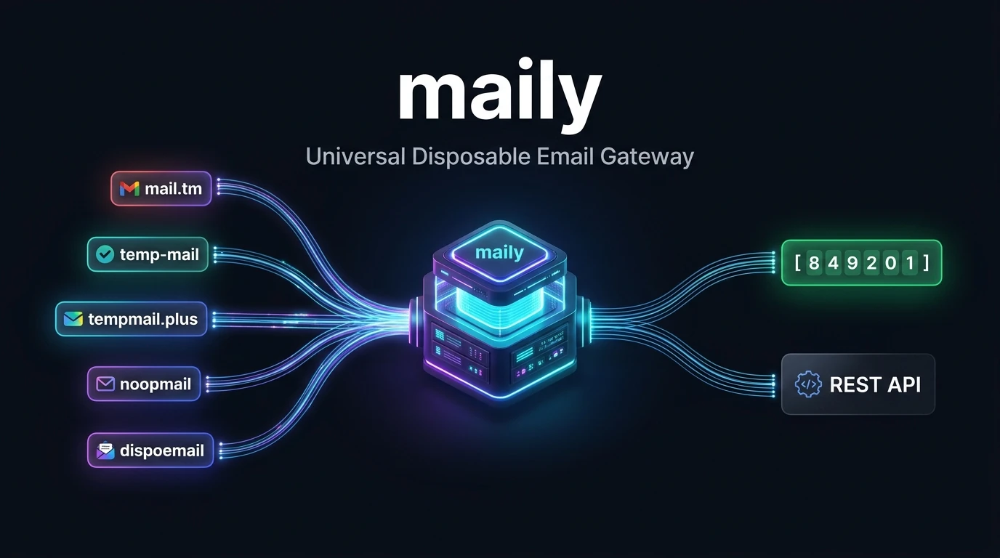

<p align="center">
  
</p>

<div align="center">

# ✉️ maily

### Универсальный шлюз временной почты и платформа REST API

**Укрощение «зоопарка» сервисов одноразовой почты (Mail.tm, TempMail, 1secmail) в рамках единого высокопроизводительного REST API, современного асинхронного Python SDK и стильной веб-консоли.**

<br>

> ⚡ **Универсальный шлюз и REST API временной почты:** забудьте о ручной интеграции 8 несовместимых API, ежедневных блокировках доменов и хрупких регулярных выражениях. Maily выступает в качестве надёжной замены 1secmail и агрегирует Mail.tm, Tempmail Plus, Temp-Mail.io и ещё более 5 провайдеров в единый REST-шлюз с автоматическим извлечением проверочных OTP-кодов и ссылок активации в 1 строчку для Playwright, Pytest и QA-ботов.

<br>

[](https://github.com/stormsia/maily/actions/workflows/ci.yml)
[](https://github.com/stormsia/maily/actions/workflows/codeql.yml)
[](https://github.com/stormsia/maily/actions/workflows/pip-audit.yml)
[](https://github.com/stormsia/maily/actions/workflows/gitleaks.yml)
[](https://codecov.io/gh/stormsia/maily)
[](https://github.com/stormsia/maily/pkgs/container/maily)
[](https://pypi.org/project/maily-server/)
[](https://pypi.org/project/maily-client/)
[](https://stormsia.github.io/maily/)
[](https://github.com/stormsia/maily)
[](https://github.com/stormsia/maily/blob/main/LICENSE)

[📖 Интерактивная документация & Swagger](https://stormsia.github.io/maily/) •
[🚀 Серверный пакет (PyPI)](https://pypi.org/project/maily-server/) •
[📦 Клиентский SDK (PyPI)](https://pypi.org/project/maily-client/) •
[🐳 Образ Docker GHCR](https://github.com/stormsia/maily/pkgs/container/maily) •
[🌐 Онлайн-статус провайдеров](#-онлайн-статус-и-доступность-провайдеров) •
[⚡ Быстрый старт](#-быстрый-старт-quickstart) •
[🧪 Рецепты для автотестов](#-рецепты-автоматизации-тестов-pytest-playwright-selenium)

<br>

**Языки:** [English](https://github.com/stormsia/maily/blob/main/README.md) • [Русский](https://github.com/stormsia/maily/blob/main/README.ru.md) • [简体中文](https://github.com/stormsia/maily/blob/main/README.zh-CN.md)

</div>

---

## 🦁 Зачем нужен Maily? Укрощение «зоопарка» временной почты

Интеграция временной почты в автотесты, CI/CD пайплайны или боты обычно превращается в кошмар сопровождения:

* 💥 **8+ несовместимых хрупких API** — у каждого свои заголовки, специфичный формат JSON, нестандартные таймштампы или отсутствие сырого MIME.
* 🛑 **Случайные даунтаймы и блокировки доменов** — домены попадают в спам-листы ежедневно, ломая ваши E2E-тесты без предупреждения.
* 🧩 **Сложный парсинг регулярками** — приходится постоянно писать и поддерживать регулярки для выуживания 4–8 значных OTP-кодов и ссылок активации из HTML.
* 🔓 **Отсутствие безопасности и изоляции** — нет разграничения доступа, шифрования секретов, аудита и очистки устаревших данных.

**Maily решает эту проблему раз и навсегда.** Он действует как надёжный высокодоступный шлюз-абстракция над всей экосистемой временной почты. Переключайте или ротируйте провайдеров одним параметром, мгновенно извлекайте коды подтверждения и управляйте всем процессом через тёмную веб-панель или асинхронный Python SDK.

| Возможность | Разрозненный зоопарк сервисов ❌ | Универсальный шлюз Maily ⚡ |
|---|---|---|
| **Единообразие API** | 8+ различных эндпоинтов, схем и правил авторизации | **Единый нормализованный REST API и Python SDK** |
| **Надёжность доменов** | Единая точка отказа; тесты падают при бане домена | **40+ ротируемых доменов среди 8 провайдеров** |
| **Извлечение OTP-кодов** | Ручной скрапинг HTML, регулярные выражения, циклы опроса | **`await api.wait_for_code(box)` (готовое извлечение в 1 строку)** |
| **Ссылки активации** | Захардкоженные URL-паттерны | **`await api.wait_for_link(box)` с авто-оценкой скоринга** |
| **Клиентские движки** | Самописные HTTP-запросы без обработки ретраев 429/502 | **Нативный Async (`Maily`) + Синхронный фасад (`SyncMaily`)** |
| **Наблюдаемость** | Слепое выполнение; логи разбросаны | **Тёмная веб-консоль с телеметрией и графиками в реальном времени** |
| **Безопасность** | Публичные эндпоинты без контроля ключей | **Многопользовательские Scoped API ключи и шифрование Fernet** |
| **Обслуживание БД** | Зависшие ящики и разрастание диска | **Фоновый сборщик устаревших данных + VACUUM без простоя** |

---

## 🏗️ Архитектура и поток данных

```mermaid
flowchart LR
    subgraph Clients["1. Клиенты и тестовые фреймворки"]
        direction TB
        pytest["Pytest Automation"]
        playwright["Playwright / Selenium"]
        bot["QA Боты и скраперы"]
        sdk["maily-client (Async / Sync)"]
    end

    subgraph Gateway["2. Единое ядро Maily"]
        direction TB
        fastapi["FastAPI Core"]
        extractor["Парсер OTP и ссылок"]
        rbac["RBAC и Fernet Vault"]
        cache["Кэш доменов и авто-отказоустойчивость"]
        retention["Retention Sweeper и SQLite WAL"]
        ui["Веб-интерфейс (Dashboard)"]
    end

    subgraph Zoo["3. Зоопарк Temp Mail"]
        direction TB
        p1["Mail.tm"]
        p2["TempMail.Plus"]
        p3["Temp-Mail.io"]
        p4["NoopMail.org"]
        p5["AnonymMail.net"]
        p6["DispoEmail.org"]
        p7["Temp.tf"]
        p8["Gmail OAuth2 + Алиасы"]
    end

    Clients -->|Единый REST / SDK запрос| Gateway
    Gateway -->|Унифицированный адаптер| Zoo
```



---

## ✨ Ключевые возможности

- **8 интегрированных провайдеров «из коробки»** — объединение публичных сетей временной почты и аккаунтов Gmail:
  - `mail.tm` — высокая надёжность, кастомные имена, пароли, сырой MIME.
  - `tempmail.plus` — кастомные логины, защита PIN-кодом, домены, MIME.
  - `temp-mail.io` — одноразовые ящики с авто-токенами CORS.
  - `noopmail.org` — ротация доменов и инспекция исходного кода письма.
  - `anonymmail.net` — временная почта с сессиями и защитой CSRF.
  - `dispoemail.org` — сессионная одноразовая почта.
  - `temp.tf` — реальные алиасы на Outlook, Hotmail, Gmail и др.
  - `gmail` — интеграция через OAuth2 с неограниченными адресами `username+alias@gmail.com`.
- **⚡ Автоматическое извлечение OTP-кодов** — ожидание входящего письма и извлечение 4–8 значного кода (например, `849201`) или ссылки подтверждения в один вызов.
- **🐍 Асинхронный клиент (`maily-client`)** — легковесный автономный пакет (`httpx`, `pydantic`, `loguru`) с поддержкой async/await, синхронным фасадом, контекстными менеджерами и строгой типизацией.
- **📡 Потоковая передача писем (Streaming)** — получение новых сообщений в реальном времени через `async for message in api.messages.iter_messages(box): ...`.
- **🖥️ Тёмная веб-панель управления** — современный интерфейс с графиками активности, предпросмотром писем, подсветкой проверочных кодов и встроенным Swagger UI на `/docs`.
- **🔑 Ограниченные API-ключи (Scoped RBAC)** — мастер-ключи и ключи с гранулярными правами (ограничение по провайдерам, действиям и TTL).
- **🧹 Автоматическая очистка и обслуживание SQLite** — периодическое удаление устаревших ящиков и сообщений вместе с дефрагментацией БД (WAL truncate, VACUUM, REINDEX, ANALYZE) без блокировки сервиса.

---

## 🌐 Поддерживаемые провайдеры

| Провайдер | Тип таргета | Свой логин | Свой домен | Пароль / PIN | Сырой MIME | Отметка о прочтении |
|---|---|---|---|---|---|---|
| **mail.tm** | `domain` | ✅ Да | ✅ Да | ✅ Пароль | ✅ Да | ✅ Да |
| **tempmail.plus** | `domain` | ✅ Да | ✅ Да | ✅ PIN | ✅ Да | ✅ Да |
| **temp-mail.io** | `domain` | ✅ Да | ✅ Да | ❌ Нет | ✅ Да | ⚪ No-op |
| **noopmail.org** | `domain` | ✅ Да | ✅ Да | ❌ Нет | ✅ Да | ⚪ No-op |
| **anonymmail.net** | `domain` | ✅ Да | ✅ Да | ❌ Нет | ✅ Да | ⚪ No-op |
| **dispoemail.org** | `domain` | ✅ Да | ✅ Да | ❌ Нет | ✅ Да | ⚪ No-op |
| **temp.tf** | `domain` | ✅ Да | ✅ Да | ❌ Нет | ✅ Да | ⚪ No-op |
| **gmail** | `parent` | ✅ `+алиас` | ❌ Свой аккаунт | ❌ OAuth2 | ✅ Да | ✅ Да |

---

## 📋 Системные требования (Prerequisites)

Перед запуском Maily убедитесь, что в системе установлены:

| Компонент | Минимальная версия | Рекомендуется | Назначение |
|---|---|---|---|
| **Docker Engine** | `>= 24.0` | Последняя | Для запуска готового контейнера (`ghcr.io/stormsia/maily`) |
| **Docker Compose** | `v2.20+` | Последняя | Поддержка формата Compose v2 |
| **Python** (для исходников и SDK) | `>= 3.13` | `3.13` | Высокопроизводительный асинхронный рантайм |
| **uv** (для разработки) | `>= 0.4.0` | Последняя | Быстрый менеджер пакетов и виртуальных окружений |

---

## 🚀 Быстрый старт (Quickstart)

### Вариант А — Docker (Рекомендуемый, без сборки из исходников)

Запустите официальный готовый образ одной командой:

```bash
docker run -d \
  --name maily \
  -p 8477:8477 \
  -e MAILY_API_KEY=your_secret_api_key \
  -v maily_data:/data \
  --restart unless-stopped \
  ghcr.io/stormsia/maily:latest
```

Или через Docker Compose (скачав только конфигурационный файл):

```bash
# Linux / macOS
curl -O https://raw.githubusercontent.com/stormsia/maily/main/docker-compose.prod.yml
docker compose -f docker-compose.prod.yml up -d

# Windows (PowerShell)
Invoke-WebRequest -Uri https://raw.githubusercontent.com/stormsia/maily/main/docker-compose.prod.yml -OutFile docker-compose.prod.yml
docker compose -f docker-compose.prod.yml up -d
```

- Панель управления: <http://127.0.0.1:8477/>
- Интерактивная документация Swagger: <http://127.0.0.1:8477/docs>

---

### Вариант Б — Запуск из исходного кода / Разработка

```bash
git clone https://github.com/stormsia/maily.git && cd maily
cp .env.example .env
docker compose up -d --build
```

Либо на локальном Python (3.13+):

```bash
uv venv
source .venv/bin/activate  # На Windows: .venv\Scripts\activate
uv pip install -e ".[dev]"
uvicorn maily.app.main:create_app --factory --reload --port 8477
```

---

## 🐍 Использование Python SDK (`maily-client`)

Установите клиентский пакет:

```bash
pip install maily-client
```

### Создание ящика и получение кода в 1 вызов:

```python
import asyncio
from maily_client import Maily, WaitTimeoutError


async def main():
    async with Maily("http://127.0.0.1:8477", api_key="your_secret_api_key") as api:
        # Автоматический выбор доступного провайдера и домена
        box = await api.create_temp_mailbox()
        print(f"Одноразовый email: {box.address}")

        try:
            # Ожидание письма и автоматическое извлечение OTP кода
            code = await api.wait_for_code(box, timeout=60.0)
            print(f"Получен проверочный код: {code}")
        except WaitTimeoutError:
            print("Превышено время ожидания письма.")


asyncio.run(main())
```

### Синхронный режим (`SyncMaily`):

```python
from maily_client import SyncMaily

with SyncMaily("http://127.0.0.1:8477", api_key="your_secret_api_key") as api:
    box = api.create_temp_mailbox()
    code = api.wait_for_code(box, timeout=45.0)
    print(f"Код получен синхронно: {code}")
```

---

## 🧪 Рецепты автоматизации тестов (Pytest, Playwright, Selenium)

### Фикстура Pytest:

```python
import pytest
from maily_client import Maily


@pytest.fixture
async def temp_inbox():
    async with Maily("http://127.0.0.1:8477", api_key="your_secret_api_key") as api:
        box = await api.create_temp_mailbox(provider="tempmail.plus")
        try:
            yield api, box
        finally:
            await api.mailboxes.delete(box)


@pytest.mark.asyncio
async def test_user_signup_with_email_otp(temp_inbox):
    api, box = temp_inbox
    # 1. Отправляем форму регистрации на тестируемом сервисе с email box.address
    # 2. Ждем код подтверждения от Maily:
    code = await api.wait_for_code(box, timeout=30.0)
    assert len(code) in (4, 6, 8)
```

---

## ⚙️ Конфигурация (.env)

| Переменная | По умолчанию | Описание |
|---|---|---|
| `MAILY_HOST` | `127.0.0.1` | Адрес прослушивания (`0.0.0.0` в Docker) |
| `MAILY_PORT` | `8477` | Порт HTTP-сервера |
| `MAILY_API_KEY` | *(пусто)* | Мастер-ключ API (обязателен при доступе не с localhost) |
| `MAILY_DATABASE_URL` | `sqlite+aiosqlite:///mailtm.db` | Строка подключения к SQLite базе данных |
| `MAILY_SECRET_KEY` | *(автогенерация)* | Ключ Fernet для шифрования сохраненных реквизитов |
| `MAILY_PROXY` | *(пусто)* | HTTP/SOCKS5 прокси для запросов к провайдерам |
| `MAILY_RETENTION_INTERVAL_SECONDS` | `60` | Интервал фоновой очистки устаревших ящиков |
| `MAILY_DB_MAINTENANCE_ENABLED` | `true` | Включение регулярной дефрагментации SQLite |
| `MAILY_DOMAIN_CACHE_INTERVAL_SECONDS` | `1800` | Частота фонового обновления списка доменов |

---

## 🤝 Вклад в проект (Contributing)

Мы рады контрибьюторам! Подробные инструкции по разработке и созданию адаптеров новых провайдеров описаны в [CONTRIBUTING.md](CONTRIBUTING.md) и [docs/ADDING_PROVIDERS.md](docs/ADDING_PROVIDERS.md).

Пожалуйста, соблюдайте [Кодекс поведения (Code of Conduct)](CODE_OF_CONDUCT.md). По вопросам уязвимостей ознакомьтесь с [Политикой безопасности (SECURITY.md)](SECURITY.md).

---

## 📄 Лицензия

Проект распространяется под лицензией [MIT](LICENSE) © [stormsia](https://github.com/stormsia).
