<p align="center">
  
</p>

<div align="center">

# ✉️ maily

### 通用临时邮箱网关与 REST API 聚合平台

**将割裂脆弱的临时邮箱生态（Mail.tm、TempMail、1secmail 替代品）统一收敛至高性能 REST API、现代异步 Python SDK 与赛博朋克暗色控制台。**

<br>

> ⚡ **统一临时邮箱 API：** 告别 8 个不兼容的临时邮箱接口、域名频繁列入黑名单以及脆弱的正则表达式。Maily 作为高可用的 1secmail 替代方案，将 Mail.tm、Tempmail Plus、Temp-Mail.io 等 8+ 临时邮箱提供商聚合成统一的 REST 网关，支持针对 Playwright、Pytest 及自动化测试的一行代码验证码与确认链接提取。

<br>

[](https://github.com/stormsia/maily/actions/workflows/ci.yml)
[](https://github.com/stormsia/maily/actions/workflows/codeql.yml)
[](https://github.com/stormsia/maily/actions/workflows/pip-audit.yml)
[](https://github.com/stormsia/maily/actions/workflows/gitleaks.yml)
[](https://codecov.io/gh/stormsia/maily)
[](https://github.com/stormsia/maily/pkgs/container/maily)
[](https://pypi.org/project/maily-server/)
[](https://pypi.org/project/maily-client/)
[](https://stormsia.github.io/maily/)
[](https://github.com/stormsia/maily)
[](https://github.com/stormsia/maily/blob/main/LICENSE)

[📖 交互式文档与 Swagger](https://stormsia.github.io/maily/) •
[🚀 服务端核心 (PyPI)](https://pypi.org/project/maily-server/) •
[📦 客户端 SDK (PyPI)](https://pypi.org/project/maily-client/) •
[🐳 Docker 镜像 (GHCR)](https://github.com/stormsia/maily/pkgs/container/maily) •
[⚡ 快速上手](#-快速上手-quickstart) •
[🧪 自动化测试配方](#-e2e-自动化测试配方-pytest-playwright-selenium)

<br>

**语言:** [English](https://github.com/stormsia/maily/blob/main/README.md) • [Русский](https://github.com/stormsia/maily/blob/main/README.ru.md) • [简体中文](https://github.com/stormsia/maily/blob/main/README.zh-CN.md)

</div>

---

## 🦁 为什么选择 Maily？告别碎片化的临时邮箱接口

在自动化测试、QA 流程或爬虫机器人中接入临时邮箱通常面临以下痛点：

* 💥 **8+ 不兼容的脆弱 API** — 各服务商响应格式、请求头、时间戳规范各不相同，且大多缺失原始 MIME 源文件。
* 🛑 **域名被封与服务中断** — 上游邮箱域名频繁被各大平台列入黑名单，导致 CI/CD 测试流水线无预警失败。
* 🧩 **复杂的正则表达式解析** — 维护繁琐脆弱的正则，从杂乱的 HTML 中提取 4–8 位验证码与激活链接。
* 🔓 **缺乏访问隔离与安全性** — 缺乏权限控制、密钥未加密，无过期自动清理导致磁盘臃肿。

**Maily 一劳永逸地解决了这些问题。** 作为高可用抽象网关，它支持一个参数动态轮换服务商、极速提取验证码，并配有现代化暗黑控制台与全异步 Python SDK。

| 核心特性 | 传统碎片化服务 ❌ | Maily 统一网关 ⚡ |
|---|---|---|
| **API 一致性** | 8+ 完全不同的接口与认证规则 | **标准统一的 REST API 与 Python SDK** |
| **域名可靠性** | 单点故障，域名被封则流程中断 | **8 大服务商提供 40+ 动态轮换域名池** |
| **OTP 验证码提取** | 手动正则匹配、轮询与网页抓取 | **`await api.wait_for_code(box)`（1 行代码提取）** |
| **确认链接提取** | 脆弱硬编码的 URL 正则 | **`await api.wait_for_link(box)`（智能评分提取）** |
| **客户端支持** | 自行编写请求，重试逻辑易漏 | **原生 Async (`Maily`) + 同步外观 (`SyncMaily`)** |
| **可观测性** | 缺乏监控，排查日志困难 | **深色主题管理面板，实时呈现流量与图表** |
| **数据安全与隔离** | 公开接口无密钥权限隔离 | **多租户权限作用域 API 密钥 + Fernet 加密凭证** |
| **存储自愈** | 僵尸邮箱累积，占用磁盘 | **后台定期过期清理 + 零停机 SQLite WAL 碎片整理** |

---

## 🏗️ 架构与数据流

```mermaid
flowchart LR
    subgraph Clients["1. 客户端与测试工具"]
        direction TB
        pytest["Pytest Automation"]
        playwright["Playwright / Selenium"]
        bot["QA 机器人 / 爬虫"]
        sdk["maily-client (Async / Sync)"]
    end

    subgraph Gateway["2. Maily 统一引擎"]
        direction TB
        fastapi["FastAPI 高性能核心"]
        extractor["OTP 验证码与链接提取器"]
        rbac["RBAC 作用域与 Fernet 加密保险库"]
        cache["域名缓存与自动故障转移"]
        retention["定期清理与 SQLite WAL 维护"]
        ui["暗色模式 Web 管理控制台"]
    end

    subgraph Zoo["3. 临时邮箱服务群"]
        direction TB
        p1["Mail.tm"]
        p2["TempMail.Plus"]
        p3["Temp-Mail.io"]
        p4["NoopMail.org"]
        p5["AnonymMail.net"]
        p6["DispoEmail.org"]
        p7["Temp.tf"]
        p8["Gmail OAuth2 + 别名"]
    end

    Clients -->|单次 REST / SDK 调用| Gateway
    Gateway -->|统一适配引擎| Zoo
```



---

## 📋 环境要求 (Prerequisites)

在运行 Maily 之前，请确保宿主环境满足以下要求：

| 组件 | 最低版本 | 推荐版本 | 说明 |
|---|---|---|---|
| **Docker Engine** | `>= 24.0` | 最新稳定版 | 容器化部署模式 (`ghcr.io/stormsia/maily`) |
| **Docker Compose** | `v2.20+` | 最新稳定版 | 支持 Compose v2 语法 |
| **Python** (源码或 SDK) | `>= 3.13` | `3.13` | 支持自由线程与优化异步 I/O |
| **uv** (源码开发环境) | `>= 0.4.0` | 最新版 | 超高速 Python 依赖管理工具 |

---

## 🚀 快速上手 (Quickstart)

### 方案 A — Docker 镜像（推荐，无需拉取源码）

使用预构建的官方镜像一键启动：

```bash
docker run -d \
  --name maily \
  -p 8477:8477 \
  -e MAILY_API_KEY=your_secret_api_key \
  -v maily_data:/data \
  --restart unless-stopped \
  ghcr.io/stormsia/maily:latest
```

或使用 Docker Compose 快速部署：

```bash
# Linux / macOS
curl -O https://raw.githubusercontent.com/stormsia/maily/main/docker-compose.prod.yml
docker compose -f docker-compose.prod.yml up -d

# Windows (PowerShell)
Invoke-WebRequest -Uri https://raw.githubusercontent.com/stormsia/maily/main/docker-compose.prod.yml -OutFile docker-compose.prod.yml
docker compose -f docker-compose.prod.yml up -d
```

- Web 控制台：<http://127.0.0.1:8477/>
- Swagger 接口文档：<http://127.0.0.1:8477/docs>

---

### 方案 B — 源码构建与本地开发

```bash
git clone https://github.com/stormsia/maily.git && cd maily
cp .env.example .env
docker compose up -d --build
```

本地原生 Python (3.13+) 运行：

```bash
uv venv
source .venv/bin/activate  # Windows 环境: .venv\Scripts\activate
uv pip install -e ".[dev]"
uvicorn maily.app.main:create_app --factory --reload --port 8477
```

---

## 🐍 Python SDK 使用 (`maily-client`)

安装轻量独立客户端：

```bash
pip install maily-client
```

### 1 行代码创建邮箱并提取验证码：

```python
import asyncio
from maily_client import Maily, WaitTimeoutError


async def main():
    async with Maily("http://127.0.0.1:8477", api_key="your_secret_api_key") as api:
        # 自动选择健康可用的提供商创建邮箱
        box = await api.create_temp_mailbox()
        print(f"生成的临时邮箱: {box.address}")

        try:
            # 持续监听收件箱并自动提取 4-8 位验证码
            code = await api.wait_for_code(box, timeout=60.0)
            print(f"提取到的验证码: {code}")
        except WaitTimeoutError:
            print("等待邮件超时。")


asyncio.run(main())
```

### 同步客户端调用 (`SyncMaily`)：

```python
from maily_client import SyncMaily

with SyncMaily("http://127.0.0.1:8477", api_key="your_secret_api_key") as api:
    box = api.create_temp_mailbox()
    code = api.wait_for_code(box, timeout=45.0)
    print(f"同步获取验证码成功: {code}")
```

---

## 🧪 E2E 自动化测试配方 (Pytest, Playwright, Selenium)

```python
import pytest
from maily_client import Maily


@pytest.fixture
async def temp_inbox():
    """为每次测试提供隔离的临时邮箱并在测试结束后销毁"""
    async with Maily("http://127.0.0.1:8477", api_key="your_secret_api_key") as api:
        box = await api.create_temp_mailbox(provider="tempmail.plus")
        try:
            yield api, box
        finally:
            await api.mailboxes.delete(box)


@pytest.mark.asyncio
async def test_user_signup_with_email_otp(temp_inbox):
    api, box = temp_inbox
    # 1. 在待测系统填写注册并发送验证码至 box.address
    # 2. 从 Maily 异步等待提取验证码:
    code = await api.wait_for_code(box, timeout=30.0)
    assert len(code) in (4, 6, 8)
```

---

## ⚙️ 配置说明 (.env)

| 环境变量 | 默认值 | 作用说明 |
|---|---|---|
| `MAILY_HOST` | `127.0.0.1` | 绑定监听地址（Docker 内为 `0.0.0.0`） |
| `MAILY_PORT` | `8477` | HTTP 端口 |
| `MAILY_API_KEY` | *(空)* | Master API Key（非本机访问必须配置） |
| `MAILY_DATABASE_URL` | `sqlite+aiosqlite:///mailtm.db` | SQLite 数据库连接 URL |
| `MAILY_SECRET_KEY` | *(自动生成)* | Fernet 加密密钥，用于敏感凭证加密 |
| `MAILY_PROXY` | *(空)* | 请求外部提供商的上游 HTTP/SOCKS5 代理 |
| `MAILY_RETENTION_INTERVAL_SECONDS` | `60` | 后台过期数据清理频率（秒） |
| `MAILY_DB_MAINTENANCE_ENABLED` | `true` | 是否启用 SQLite 自动维护（VACUUM / WAL 阶段截断） |
| `MAILY_DOMAIN_CACHE_INTERVAL_SECONDS` | `1800` | 提供商域名池缓存轮询刷新周期 |

---

## 🤝 贡献代码 (Contributing)

欢迎提交 Issue 和 Pull Request！详细指引请参考 [CONTRIBUTING.md](CONTRIBUTING.md) 和 [docs/ADDING_PROVIDERS.md](docs/ADDING_PROVIDERS.md)。

请遵守项目的 [行为准则 (Code of Conduct)](CODE_OF_CONDUCT.md)。安全漏洞报告请遵循 [安全策略 (SECURITY.md)](SECURITY.md)。

---

## 📄 开源许可证

本项目基于 [MIT](LICENSE) 开源协议 © [stormsia](https://github.com/stormsia)。
